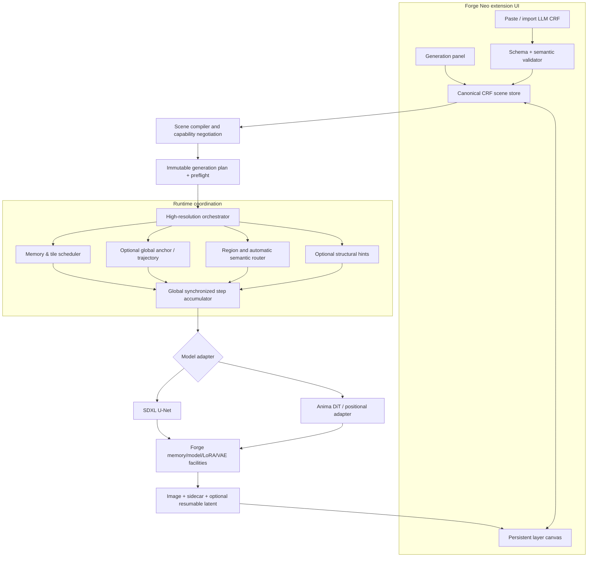

# Coherent Diffusion — Forge Neo Extension
## Consolidated research, product specification, technical architecture, and implementation plan

**Document status:** Design proposal / implementation baseline, not a claim of completed software  
**Revision:** 0.1 — 24 October 2026  
**Host:** Stable Diffusion WebUI Forge Neo (`Haoming02/sd-webui-forge-classic`, `neo` branch)  
**Primary model families:** SDXL (including photographic fine-tunes and their accelerated variants) and Anima (including the user's Q4 GGUF text-encoder setup)  
**Core objective:** Native **high-resolution txt2img** synthesis at resolutions exceeding what a full-canvas denoising pass can fit into available VRAM, with global semantic coherence, regional control, and robust low-memory execution. Conventional upscaling is **not** the principal feature.

> **Evidence convention:** **[U]** = user requirement; **[R-A/B/C]** = finding or proposal in supplied research; **[V]** = independently checked against a primary repository/paper; **[D]** = our engineering design choice/inference; **[P]** = unproven until tested in actual Forge Neo. The three supplied studies are independent *reports*, not three independent experimental replications. Repeated claims in them do not become verified measurements.

---

# 1. Executive decision

Build **one extension with a shared composition/document model and execution coordinator**, but **two model-specific execution backends**, not a direct merger of DemoFusion, AccDiffusion v2, and Forge Couple source files.

The extension provides three high-resolution synthesis policies:

1. **Coherent Progressive (recommended initial quality path):** Establish an image-wide low-resolution composition/latent trajectory and refine it through synchronized high-resolution tiled diffusion. This is a high-resolution *generative* pass, not merely pixel interpolation or an ESRGAN-only upscale. It necessarily uses lower-resolution intermediate imagery, so the distinction should be visible to users.
2. **Coherent Direct Tiled (research/advanced path):** Initialize the requested full-resolution latent canvas from noise and denoise it in globally synchronized work windows, with low-frequency/global communication where affordable. Unlike independent per-tile txt2img, this shares a single time state and image-wide latent. Its ability to preserve unique objects without an anchor is **unproven**.
3. **Controlled Composition:** Either policy with explicitly authored CRF regions, masks, prompts, LoRAs, optional structural maps and positional constraints. Automatic and user-specified regional decomposition can coexist.

The core implementation should be a **synchronous full-canvas diffusion scheduler whose model evaluations are windowed**, plus model-aware global guidance and a **persistent non-destructive editor**. Local tiles are computational *views of one scene*, not four independent scenes.

## Decisions that are firm now

| Topic | Decision | Confidence |
|---|---|---|
| Primary workflows | Native target-resolution txt2img, not upscale-first | User requirement [U] |
| Model targets | SDXL and Anima from the initial feasibility phases | [U], [V] |
| Layout/control interface | Persistent multi-layer canvas; all regions visible while editing | [U] |
| External interoperability | Versioned CRF JSON for pasting LLM/workflow output and round-trip export | [U], [D] |
| Architecture | Shared orchestration, distinct SDXL/Anima model adapters | High [V], [D] |
| Global coherence | Separate algorithm family from seam/overlap blending | High [V] |
| Memory policy | Sequential windows, model-native offload and tiled VAE; host latent if beneficial | High [D], runtime limits [P] |
| Regional conditioning | Masked text conditioning first; more expensive LoRA prediction blending next | High [V], isolation [P] |
| Forge integration | Reuse Forge loading, samplers, VAE, LoRAs and controls; avoid permanent global monkey-patches | High [V], API details [P] |
| Algorithms | DemoFusion/AccDiffusion v2 as primary SDXL baselines; investigate HiFlow/ResDiT/HRDiT for Anima | Medium [V], portability [P] |

**Do not ship any claim that this will fit 4096² on 4 GB, that it guarantees exactly one sun, or that masked LoRAs are perfectly isolated until those statements have corresponding tests.**

---

# 2. Source synthesis: what the three reports actually establish

The full submitted source material comprised:

- **Report A:** `native-high-resolution-regional-synthesis-in-forge-neo--technical-research,-feasibility,-and-protocol-specif (2).zip` → `report.md` (approximately 114 KB), plus methodology, source and preview files.
- **Report B:** `architectural-research-and-feasibility-report--native-high-resolution-regional-synthesis-for-forge-neo(2).zip` → `report.md` (approximately 122 KB), plus supplementary files.
- **Report C:** `deep-research-report (5).md` (approximately 47 KB).

Both ZIP reports also contain `thoughts.md` and link inventories. Their **published report content** is used for design synthesis; research-note reasoning is not treated as independent evidence. The actual Forge Neo installation, loaded model files and runtime have **not** been inspected or benchmarked in this task.

## 2.1 Agreement across the reports

1. **Identical full-scene text in every patch can cause repeated subjects.** AccDiffusion v2 independently documents this mechanism; it is more fundamental than insufficient overlap. [V:S2]
2. **Overlap blending is not global understanding.** MultiDiffusion-style tile averaging mainly helps seams; global object counts and topology require global information. DemoFusion, AccDiffusion v2 and SyncDiffusion provide distinct mechanisms. [V:S1–S3]
3. **A global-first/progressive path is the most defensible quality baseline.** DemoFusion and AccDiffusion v2 supply concrete SDXL references. They are not turnkey Anima implementations. [V:S1–S2]
4. **Forge already has relevant facilities.** Its documented capabilities include Anima variants, MultiDiffusion, tiled VAE convolution, Anima region controls and LLLite support. Forge Couple demonstrates regional attention in SDXL and Anima. [V:S4–S5]
5. **Regional text and regional LoRAs are distinct.** Masking cross-attention outputs does not spatially mask every model-weight modification. [V:S5], [D]
6. **One canonical composition document is preferable to parallel prompt-lines, masks and geometry tables.** This is supported by the observed Forge Couple draw–save–load and mapping issues, and is the design choice adopted here. [V:S5], [D]
7. **A low-VRAM scheduler must be orthogonal to the visual-coherence algorithm.** Offloading the latent canvas alone does not solve model activations or model-weight residency. [D], [V:S4]

## 2.2 Material disagreements and necessary corrections

| Claim appearing in one or more reports | Assessment | Binding design consequence |
|---|---|---|
| 4 GB reliably supports a specified maximum 2K–3K and 6–8 GB reliably supports 4K with specified wall times | **Unsupported extrapolation** from approximate footprints/hardware assumptions; these are not measurements on the target Forge/Anima stack | No fixed resolution ceiling or timing promise; measure actual VRAM, RAM, tile activations and per-step latency |
| A 1024² anchor takes ~2–5 seconds | Depends drastically on GPU, model variant, offload and sampler; not portable to 4 GB hardware | No hard-coded timing or performance budget borrowed from papers |
| Attention-level regional control is zero-overhead or within 5% regardless of region count | Unsupported: Forge Couple explicitly expands conditional paths and intermediate tensors | Region count and prompt length must be treated as memory/compute variables |
| Token-indexed LoRA deltas guarantee strict region confinement | Incorrect as a general guarantee: convolution, self-attention, TE changes and the next diffusion steps transfer information | Distinguish **approximate**, **prediction-blended** and experimental internal masking, and measure leakage |
| Applying an object token only where anchor cross-attention exceeds a threshold automatically preserves object counts | Valuable hypothesis, not a correctness guarantee; token attention can be diffuse, unavailable with fused attention, or misleading | Optional, validated region proposal method; never silently rewrite quantity words in prompts |
| All Anima versions share a single Qwen text encoder configuration | Version/variant-dependent. Forge documents 2B, 2.9B, 3.8B and optional adapter differences | Runtime capability introspection; do not bind architecture to one hard-coded encoder graph |
| GGUF is natively supported in current Forge Neo | **Conflicts with current upstream README**, which explicitly lists “GGUF Support” as removed. The user's installed Q4 text-encoder workflow may be supplied by an extension or local patch | Detect/retain the user's working loader and encoding path; test its exact build before promising support [V:S4] |
| Global RoPE offsets or an alternative scaling recipe alone fix Anima tiling | Relevant direction, **not yet established for Anima** | Dedicated token-layout/3D RoPE feasibility gate and quality regressions |
| Upstream code can all be copied under a permissive license | Not established. Forge Neo is AGPL-3.0; Forge Couple carries GPL-3.0; some research repositories have no obvious license | File-by-file provenance and license review before vendoring source |
| Progressive anchor + refinement is identical to generating a single full-resolution image directly from noise | Not identical | Expose “Progressive” versus “Direct” explicitly, with proper terminology |

**Additional correction:** A DiT or U-Net does **not** inherently require retaining the full denoising autograd graph at inference; inference runs without training gradients. The actual risks are model weights, attention/workspace, activations, offload traffic and optional controls. The reports occasionally conflate these categories.

## 2.3 Contributions retained from each report

**A — broad feature and algorithm coverage:** useful FreeScale, HiDiffusion and positional-extrapolation survey; canvas, CRF, memory and licensing checklists. Its numeric 4/6/8/12 GB performance tables are *planning guesses*, not guarantees. Its recommendation of internal masked LoRA deltas is retained only as an experimental candidate.

**B — integration and UX detail:** useful Forge-level hook/control concerns, persistent layered editor design, effective region heatmaps and compatibility requirements. Its DWT/automatic multiplicity rewrite and particular Anima RoPE recipes are experiments, not selected core architecture.

**C — caution and engineering sequencing:** strongest methodological discipline: use source probes first; do not equate seam quality with semantics; adopt capability negotiation, transactional hook cleanup, benchmark-first decisions and no invented VRAM claims. Its recommended dual-mode strategy is the baseline adopted here.

---

# 3. Independent primary-source research and algorithm shortlist

Sources were checked against live upstream documentation or first-party papers on 24 October 2026. The following is a **design review and source inspection**, not an empirical image benchmark. Publication claims are recorded as literature claims unless reproduced locally.

| Approach | Verified mechanism and potential value | SDXL | Anima | Design status |
|---|---|---|---|---|
| **DemoFusion** [S1] | Progressive resolution, skip-residual guidance, dilated sampling and local/global fusion | First-class baseline | Conceptual translation only | **Prototype** |
| **AccDiffusion v2** [S2] | Patch-content-aware prompts, structural guidance, window-interacting dilated sampling; attacks repeated objects and local distortion | Primary semantic-coherence baseline | Research port needed | **Prototype concepts; independent implementation if license unclear** |
| **MultiDiffusion** [S4] | Overlap/weighted denoiser predictions on one latent; helps seamless generation but not unique-object semantics | Existing host baseline | Host-specific feasibility | **Engine primitive / negative baseline** |
| **HiDiffusion** [S6] | RAU-Net and shifted-window attention address U-Net feature redundancy and scale extrapolation | Candidate optimization | RAU-Net inapplicable to non-U-Net DiT | **Optional SDXL experiment** |
| **ElasticDiffusion** [S7] | Global–local score separation and reduced-resolution guidance | Comparison candidate | No demonstrated portable implementation | **Benchmark, not foundation** |
| **SyncDiffusion** [S3] | Perceptual synchronization across windows | Comparison candidate | Memory/gradient burden | **Research-only initially** |
| **FreeScale** [S8] | Multi-scale frequency fusion, 8K reported by authors | Relevant global/local guidance | Portability unproven | **Experimental global regularizer** |
| **DiffuseHigh** [S9] | Progressive structure-guided high-resolution generation | Comparison of anchor strategies | Portability unproven | **Research candidate** |
| **HiFlow** (NeurIPS 2025) [S10] | Flow-aligned high-resolution reference trajectory including initialization/direction/acceleration alignment | May inform flow variants | **Very relevant to flow-model research**, not tested on Anima here | **Anima research priority** |
| **ResDiT** (CVPR 2026) [S11] | Position-embedding rescaling, local enhancement and global/local patch fusion for DiTs | Not necessary for U-Net path | **High relevance to positional problem** | **Anima research priority** |
| **HRDiT** (ECCV 2026) [S12] | Spatial Position Alignment (SPA), Head-adaptive Attention Pruning (HAP) demonstrated on FLUX.1-dev | Not primary | **Relevant ideas, not a plug-in** | **Benchmark concepts; low-VRAM viability unproven** |
| **ScaleCrafter** [S13] | U-Net receptive-field scaling | Candidate SDXL baseline | No direct DiT application | **Lower priority** |
| **Forge Couple** [S5] | Masked regional cross-attention, masks, advanced mapping; supports Anima in current version | Confirmed implementation concept | Confirmed implementation concept | **Regional conditioning reference** |

### 3.1 Newly important observations beyond the submitted studies

**ResDiT and HRDiT substantially strengthen the DiT-specific research path.** ResDiT (CVPR 2026) explicitly studies how position embeddings fail on high-resolution DiTs and combines positional correction with local enhancement. HRDiT (ECCV 2026) introduces bundle-aware spatial alignment and per-head attention pruning. HRDiT's own official repository reports **about 46 GiB peak memory for 4096² FLUX.1-dev**, including model weights, on its reference implementation; that is emphatically **not** evidence of 4 GB operation or Anima compatibility. Their mechanisms merit *selective experiments*, not blind imports. [V:S11–S12]

**HiFlow matters because Anima is not simply SDXL with a different attention module.** Flow-trajectory alignment may be more directly useful than applying SDXL epsilon-prediction blending formulae verbatim to velocity-prediction or flow-matching schedules. But the ability to call a method “model-agnostic” in a paper does not establish it works under Forge Neo's Anima implementation. [V:S10]

**Forge Neo's surface is changing.** Its October documentation lists newer model support, rewritten samplers and removed GGUF support. We need to pin and record the user's running Forge commit, installed patches, and Q4 encoder implementation before implementing an integration layer. [V:S4]

### 3.2 Algorithm selection policy

Do **not** add every research method as a permanent UI toggle. A small set of testable strategies should be implemented behind stable internal contracts. New interventions are admitted only if they improve the fixed quality or efficiency test suite without breaking a model family's correctness.

- **Baseline B0:** Host native-generation resolution, no extension.
- **Baseline B1:** Full-canvas synchronized naive tiled denoising, no semantic/global stabilization.
- **B2:** Global anchor + tiled synchronized denoising (DemoFusion-inspired).
- **B3:** B2 + patch-aware prompt routing and selective global interaction (AccDiffusion-v2-inspired).
- **B4:** Alternative global/frequency/flow alignment (FreeScale/HiFlow research).
- **B5:** DiT positional interventions (ResDiT/HRDiT-inspired), independently ablated from B2/B3.

A feature is **promoted** only if its effect can be isolated in ablation runs. Multiple cross-attention or RoPE hacks applied together without attribution are specifically prohibited.

---

# 4. Product scope and principles

## 4.1 Must-have capabilities (P0/P1)

- [ ] Generate a full-resolution txt2img image with an image-wide seed, one scheduler progression and coordinated overlapping tiles, without requiring full image latent processing on GPU.
- [ ] Preserve a coherent large-scale composition and reduce repeated unique objects beyond naive tiling, with an optional global-first strategy.
- [ ] Work with SDXL photo fine-tunes and Anima through separate, actively tested backends.
- [ ] Use the user's **existing** Anima Q4 GGUF text-encoder route when available, rather than forcing model conversion, duplicate loading or cloud use.
- [ ] Work at low VRAM by processing tiles/microbatches sequentially and reusing Forge's memory management; provide truthful preflight and failure reporting.
- [ ] Provide prompt-global style, global scene semantics and optional explicit regions; never force users to draw regions for normal operation.
- [ ] Provide a truly persistent **multi-region visual canvas**, with **all prior regions visible during every new drawing operation** and direct prompt/LoRA binding.
- [ ] Import/export portable **Coherent Regions Format (CRF)** JSON from a clipboard/LLM/external workflow, including correct normalized placement.
- [ ] Support rectangles, polygons, painted masks, overlap weights and clear behavior for gaps.
- [ ] Display the *effective* regional conditioning coverage; display overlay opacity separately from conditioning intensity.
- [ ] Support region-specific LoRAs with accurately labeled isolation policy, and early capability errors where unsupported.
- [ ] Preserve native Forge sampling/model controls and cleanly unwind every patch after completion, interruption or failure.
- [ ] Save editable scene documents, reproducibility metadata, and intermediate progress where feasible.

## 4.2 Nice-to-have, explicitly gated

- Advanced HiDiffusion optimization (SDXL only), positional/extrapolation methods for Anima, optional lightweight structural maps, optional ControlNet/LLLite integration, per-region regeneration/inpainting, automatic proposals from attention maps or a user-provided LLM, accelerated DMD/Turbo model profiles, and advanced blend visualization.

## 4.3 Non-goals for first release

- Training/fine-tuning checkpoints or LoRAs.
- Replacing Forge's checkpoint loader, VAE decoder, ControlNet stack or extension host.
- An always-on LLM/captioner/segmentation model, cloud service, model download, or requirement for internet connectivity.
- Guarantee of perfect unique-object counts, exact arbitrary-pixel LoRA isolation or unlimited canvas resolution.
- Treating high-resolution txt2img as a conventional upscaler; separate img2img/tiled upscale support can follow after core txt2img.
- Modifying global Forge settings or other extensions permanently on enable/disable.

## 4.4 User-facing quality principle

The default user journey should remain **Prompt → Resolution → Coherent Progressive → Generate**. The regional editor and memory policy must remain accessible without requiring the user to understand the papers. “Advanced” parameters should be available but not part of a complicated default form.

---

# 5. Logical architecture



## 5.1 Modules and ownership

| Module | Responsibilities | Must not do |
|---|---|---|
| `ui/` | Canvas, layer stack, prompt inspector, import preview, heatmaps, progress/diagnostics | Parse diffusion tensors or own model weights |
| `crf/` | Schema/versioning, normalized geometry, assets, validation, import/export, migration | Depend on Gradio internal state or model hooks |
| `scene/` | Global scene intent, region/entity identity, inheritance, mask rasterization, per-window prompt selection | Duplicate unique-object prompts blindly |
| `planner/` | Capability checks; compile stable, immutable generation plan; estimate resources and schedule | Silently substitute samplers, CFG, LoRAs or geometry |
| `scheduler/` | Stage, step, tile traversal, CPU/GPU buffers, overlaps, seed/noise and solver history | Know U-Net/DiT internal block names |
| `coherence/` | Anchor/residuals, patch-aware prompts, optional dilated/global windows, experimental methods | Assume every model provides equivalent attention maps |
| `adapters/sdxl.py` | SDXL latent geometry, U-Net prediction contracts, CFG conditioning, optional U-Net interventions | Carry Anima-specific RoPE hacks |
| `adapters/anima.py` | Anima variant detection, latent/token layout, flow sampling, positional coordinates, text conditionings | Assume a fixed Qwen encoder across variants |
| `regions/` | Masked text conditioning, adapter sets, prediction blending, overlap semantics | Claim internal spatial LoRA masking from text masking alone |
| `forge_bridge/` | Guarded host hooks, model lifecycle, pre/post callbacks, tiled VAE/control paths, version probes | Persist monkey-patches across runs |
| `telemetry/` | Non-sensitive local metrics, benchmark case capture, failure metadata | Send user prompts/images over network |
| `tests/` | Model-mock tests, browser tests, live manual suite, memory/quality benchmark | Treat mocked diffusion images as evidence of visual quality |

## 5.2 Minimal backend capability contract (conceptual)

```python
class ModelAdapter(Protocol):
    def inspect_capabilities(self, loaded_model, runtime) -> Capabilities: ...
    def image_to_latent_geometry(self, width, height) -> LatentGeometry: ...
    def prepare_conditioning(self, global_scene, region_batch, loaded_encoders) -> ConditioningCache: ...
    def make_window_view(self, full_state, image_bbox, stage, sigma) -> WindowView: ...
    def predict(self, view, conditioning, adapter_set, sigma, control) -> ModelPrediction: ...
    def to_solver_quantity(self, prediction, sigma, schedule) -> CanonicalPrediction: ...
    def make_positional_context(self, window, full_canvas, stage) -> PositionalContext: ...
    def decode(self, latent, mode) -> Image: ...
    def cleanup(self) -> None: ...
```

The `CanonicalPrediction` must define **which** object is being blended (noise, x0, velocity, or solver-compatible update) and prove its conversion for that specific sampler/parameterization. An arbitrary SDXL epsilon formula applied to an Anima velocity field is not acceptable. A wrapped sampler may need to own the loop rather than hook only `apply_model`.

## 5.3 Capability negotiation

On model load and before generation, compile an explicit matrix: model family/variant, latent channels/downsample ratio, parameterization, positional encoding needs, text encoder path and quantization, text-region attention hooks, LoRA lifecycle and TE-LoRA support, ControlNet/LLLite compatibility, per-window VAE support, memory headroom and scheduler compatibility. Unsupported features produce actionable preflight errors or clearly selectable fallbacks; nothing silently degrades.

## 5.4 Integration lifecycle

1. Create immutable plan and reserve exclusive execution ownership for the duration of the run (respect Forge's generation queue).
2. Capture relevant host state, including model object, hooks, active LoRA sets, sampler options and control state.
3. Register **scoped** hooks through a central registry; chain only when composition order is defined and tested.
4. Run generation stages; record explicit state transitions and allow interruption between windows and steps.
5. In `finally`, undo hooks in reverse order; restore original model/LoRA/control/sampler state and release buffers.
6. Verify that a subsequent plain Forge generation yields the same behavior as without the extension.

Forge Couple's Anima code currently replaces `SelfCrossAttention.forward` at class level, which demonstrates capability but exposes potential patch-order collisions; our implementation must avoid copying that unguarded global-patch lifecycle. [V:S5]

# 6. Generation engine — algorithmic design

## 6.1 One global time state, many local evaluations

Each generation stage has a **master latent** `Z_t` and one global solver time/noise level `t` or `sigma`. At a given step, overlapping windows each **predict** against a frozen snapshot of `Z_t`. Only after all required windows have contributed do we commit the single global update `Z_t -> Z_next`. The engine does **not** run a complete independent sampler on each crop.

Conceptually, for a canonical solver-compatible prediction `P`:

\[
P_{\mathrm{canvas}}(p,t) = \frac{\sum_{i:p\in W_i}w_i(p)P_i(Z_t|_{W_i},t,C_i)}{\max(\epsilon,\sum_{i:p\in W_i}w_i(p))}.
\]

Then **one sampler step** transforms `Z_t` using `P_canvas`, shared solver history and the exact schedule. The blend equation is conceptual: a backend must establish whether its raw predictions can be combined directly or must first be converted to a solver-compatible quantity. Extra ControlNet, CFG and prediction-level LoRA effects must be applied in the defined order.

**Key invariants:**

- Every window at step `k` sees the **same prior global latent**, never a partially updated canvas.
- Tile enumeration order cannot change the result substantially through in-place writes; overlapping predictions accumulate into separate numerators and denominators.
- Every output location has positive weight or is covered by a defined global/base fallback.
- Tile halos are context only; only inner write cores or explicitly weighted valid regions contribute. Borders and padding are defined in **image and latent units**.
- The noise field is globally generated/canonical; noise must not be regenerated from scratch independently for each tile.
- Multistep sampler state is defined over the canvas, not reset on each work window.
- Results should be stable under traversal order; exact numerical equality is not promised across tile sizes or attention backends.

Pseudo-execution:

```python
plan = compile_scene(crf, model_caps, settings)
state = initialize_global_latent_and_noise(plan)
for stage in plan.stages:
    state = prepare_stage_from_prior_or_noise(state, stage)
    for k, sigma in enumerate(stage.schedule):
        frozen = state.snapshot_read_only()   # CPU/memmap-backed when necessary
        numerator, denominator = allocate_accumulators(stage)
        for window in schedule_windows(stage, sigma):
            crop = frozen.crop_with_halo(window)
            cond = route_conditioning(plan, window, sigma)
            pred = adapter.predict(crop, cond, window.adapter_set,
                                   sigma, window.control)
            canonical = adapter.to_solver_quantity(pred, sigma, stage.schedule)
            numerator.accumulate(window.write_core, canonical, window.weight)
            denominator.accumulate(window.write_core, window.weight)
        global_pred = numerator / denominator.clamp_min(EPS)
        state = stage.solver.advance(frozen, global_pred, k)
        checkpoint_if_needed(state, stage, k)
    save_stage_preview(state)
image = adapter.decode(state.latent, mode="forge_tiled_vae")
```

This is **algorithmic pseudocode**, not assumed to match existing Forge callback signatures. A source probe must establish precisely where in Forge the scheduler can be responsibly owned or wrapped. MultiDiffusion in Forge Neo may already implement part of this pattern; reuse its tested portions where practical. [V:S4]

## 6.2 Strategy A: Coherent Progressive

**Step A — anchor**: Encode scene prompt and optional regional plan, create a single low-area image/latent in the model's empirically safe resolution range and at the requested aspect ratio (not necessarily exactly 1024 × 1024). Preserve the anchor latent/seed, intermediate image and optional attention observations.

**Step B — staged target construction**: Lift/initialize the high-resolution latent using a validated, model-specific rule (noise-correlated residual for SDXL; independent flow alignment experiments for Anima), then execute the global synchronized tiled solver at the next target resolution. Repeat when necessary. This is *generative refinement at target scale*; detail is synthesized at the higher resolution.

**Step C — global correction**: At selected timesteps, introduce coarse low-frequency guidance or sparse/dilated views whose coverage samples the overall canvas, without requiring dense full-resolution model attention. Evaluate candidates individually:

- DemoFusion-style intermediate latent skip/residual conditioning.
- AccDiffusion-v2-style dilated/window interaction and patch-aware local prompts.
- FreeScale-style multi-scale frequency fusion.
- HiFlow-style reference flow alignment, particularly on Anima if feasible.

**Step D — structural assistance (optional)**: Create cheap layout/edge information from the anchor, CRF geometry or user-provided control maps. Delegate learned control models to Forge's existing ControlNet/LLLite implementation. Do not make preprocessing a mandatory resident model.

**Pros:** best initial prospect for coherent global composition; meaningful preview/checkpoint stages; source methods have SDXL demonstrations.  
**Cons:** intermediate composition constrains later generations, extra inference passes, possible anchor errors that cannot be fully corrected, difficult flow-schedule adaptation for Anima.  
**Release posture:** SDXL quality baseline first; Anima progressive feature only after its own proof.

## 6.3 Strategy B: Coherent Direct Tiled

Start from a **target-resolution canonical noise latent** without first generating a complete low-resolution image. Denoise the high-resolution field synchronously. Compensate for missing global context using selected sparse/global windows, periodic coarse projections, cross-window consensus or region structure. This is the closest mode to the user's literal demand for high-resolution **base generation from noise**.

Its success is an **open research risk**: on extreme extrapolation, a large canvas may contain multiple plausible suns or subjects even if step updates are synchronized. If direct mode fails composition benchmarks, retain it as advanced/experimental rather than falsely presenting it as equal in coherence to progressive mode.

## 6.4 Global semantic control and repeated objects

For an input such as `one sun over a beach`, the engine should represent a **single semantic entity** where possible, not merely broadcast the string `sun` to all windows. There are three sources of scene entities:

1. **Explicit**: CRF region(s) supplied by the user or external LLM. A sun has a stable ID, geometry and count intent.
2. **Anchor-derived**: Optional low-resolution attention/structure cues indicating where a token or entity appears. This must not require expensive attention matrices in all circumstances.
3. **Automatic text-only**: Prompt parsing or user-selected optional LLM decomposition; may be uncertain, so expose proposals and fall back gracefully.

The decomposition service should output: `entity_id`, `description`, `count_intent`, tentative geometry/region IDs, confidence and affected windows. Regions overlapping an object carry the *same entity identity and continuity constraint*, not independent instances. The global scene description may still condition an anchor/global pass, whereas the **local tile prompt contains only applicable entities, local material/style and context**. A small object spanning two windows must be described in both intersecting windows as *one continuous object*, not one independently created instance in each.

Do **not** automatically turn `3 people` into `1 person` in each tile. Such rewriting destroys the scene's multiplicity semantics and often yields wrong count. When anchor token maps are uncertain or unavailable, prefer conservative global guidance or explicit user/LLM regions to a fabricated hard region.

### Important: global style versus global scene text

Separate `global.style_prompt` (photography/medium/quality/lighting style, safe to reuse across windows) from `global.scene_prompt` (entire composition, count and spatial relationships). Repeating the latter verbatim everywhere is exactly the failure mode being solved. A full-scene prompt may be used for anchor/global passes while local windows receive **routed** scene entities. This distinction is part of the CRF contract, not just UI wording.

## 6.5 Resolution, tile size, halos and padding

Support any canvas dimensions satisfying the host/model's alignment requirements after validation. An automatic planner chooses window/tile geometry through measured model activation probes and available memory; the user may override within safe tested bounds.

- Tile size is always presented in **output-image pixels** (e.g., 768, 1024) and internally converted using the backend's actual downsampling and token patching. Do not hardcode 8× for every Anima variant.
- `context_halo_px` provides neighboring context and may be >= overlap. It is explicitly separate from `write_overlap_px` used for combining predictions.
- Use a positive, smooth taper window for overlapping write regions; normalize denominators so each pixel gets a defined contribution even at canvas edges.
- Pad/clip boundaries using a declared, tested edge policy; crop the valid write area. Spatial masks and ControlNet inputs must include the same transforms.
- Stable region/tile IDs and deterministic coverage mapping; window count grows with resolution and can cause substantial runtime even if peak VRAM stays roughly bounded.
- Optional sparse/dilated global windows require their own coordinate index mappings and must be validated against the model backend.

### Global position information

For SDXL, the U-Net's convolution/receptive-field context and conditioning size metadata need to remain coherent with the intended scene. For Anima, Forge Neo's `backend/nn/anima.py` includes `VideoRopePosition3DEmb` and `SelfCrossAttention`; therefore **tiled Anima must not reset every crop's positional frame to an unrelated origin without examination**. A proof must test global offsets/sliced or rescaled 3D position embeddings, temporal dimension handling, patch ordering, masking and an attention window's global coordinate identity. [V:S14]

A simple positional-offset patch is **not** automatically valid if the backbone constructs RoPE internally from the cropped input shape. The backend must supply a correct global positional context at each relevant transformer layer or provide a tested alternative (e.g., positional scaling/SPA). Include coordinate round-trip fixtures for tiled and untiled paths at small feasible resolutions.

## 6.6 Sampling and accelerated models

Provide **model-specific sampling profiles** and treat them as validation rules, not magic step-count converters:

- Standard SDXL: conventional samplers/schedules tested with synchronized solver history and chosen prediction parameterization.
- Same fine-tune's SDXL Turbo/DMD/Lightning variant: use its recommended timestep/sampler/CFG profile if known; check whether the windowed solver can reproduce that schedule. Few-step sampling changes the role of global correction windows and anchor lifting.
- Anima: preserve the flow/velocity or other prediction parameterization exposed by its actual Forge model and scheduler; confirm timestep direction and model-specific shift/CFG controls.

Do not infer that `steps=40, denoise=0.10` is equivalently a correct DMD four-step schedule; the effective number of low-noise evaluations does **not** reproduce the model's trained few-step trajectory. Also, img2img/upscale denoising is **separate from** high-resolution txt2img and should not contaminate default values.

---

# 7. Memory execution and performance policy

## 7.1 Distinguish five separate memory pressures

1. **Resident model weights**, including quantized modules or host-offloaded layers.
2. **Per-forward activations and attention workspace**, which depend on window dimensions, tokens, region expansion, CFG and attention implementation.
3. **Global latent, per-step solver state, accumulator and mask arrays**, often feasible in host RAM at high resolution.
4. **Text-encoder embeddings and encoder weights**, especially variant-specific Anima/Qwen encoders and optional TE-LoRAs.
5. **Optional control models/VAE/preview buffers**, which can cause OOM after sampling finishes.

A CPU-resident full latent may be cheap relative to a DiT model. For an illustrative 4096², 8× latent spatial reduction and FP16 storage, the **raw latent tensor alone** is around **2 MiB at 4 channels** or **8 MiB at 16 channels**; the actual decoder, attention, adapter and multiple workspace buffers can be far larger. These are illustrative calculations, *not measured VRAM usage or evidence of support for a specific model*. The actual latent shape must be detected.

## 7.2 Adaptive memory planner

Preflight collects: free/reserved GPU memory, Forge model offload state, available host RAM, model/encoder tensor formats, control-model footprint, tile size/halo, region count and LoRA policy. It runs or consults a **conservative cached microbenchmark per model-family/build** to estimate peak activation memory rather than extrapolating from a fictitious universal limit.

Execution policies:

- **Conservative (default on 4 GB):** one tile at a time, minimal concurrent predictions, CPU/memmap master state as necessary, Forge-native model offload, encoder release before denoising, tiled VAE.
- **Balanced:** automatically batch a few windows where measured headroom allows.
- **Performance:** opportunistic multiwindow batching, pinned transfers and asynchronous prefetch, only after correctness is established.

Adaptive degradation before a run: reduce tile microbatch → adjust tile size/halo within validated limits → stronger offload/CPU storage → optional slower control policy. Never silently change CRF semantics, remove regions, drop LoRAs, alter the seed or switch a sampler to make it fit.

When no available configuration fits, explain **which resource prevents generation** and provide explicitly selectable alternatives. OOM during execution must release resources, restore Forge hooks and return either a valid prior-stage checkpoint or a clear error; never emit a partly corrupted final image as success.

## 7.3 Host ↔ GPU transfers

- Keep the master latent and accumulators in CPU RAM or file-backed memory when this genuinely reduces VRAM footprint; use GPU storage for smaller scenes if faster and feasible.
- For each immutable global step, copy the read window + halo; run one or more conditionings; retrieve only the required solver-compatible prediction; accumulate weighted results. Synchronize before advancing the global solver.
- CPU pinned memory can accelerate CUDA transfers but excessive pinned allocations damage system responsiveness. Make pinning and asynchronous overlap measured optimizations with bounded pool sizes, not blanket mandates.
- Do not introduce `empty_cache()` per tile; it usually imposes synchronization and allocator overhead. Use established Forge lifetime management and explicit boundaries.
- Beware model layer offloading: if every tile reloads all weights, wall time can become unacceptable. Batch/reorder only where it does not corrupt time-state, conditioning or LoRA semantics; report offload transfer cost.

## 7.4 Text encoding and the user's Q4 GGUF configuration

The target is **reuse, not replacement**. Exact encoder variant and loader are runtime facts, not guessed from model family.

1. Discover the active Anima variant and its actual text-conditioning provider (native, extension, GGUF patch, alternative adapter).
2. Invoke Forge's working encode interface; cache embeddings where host APIs/LoRA state permit.
3. Cache key includes model/encoder identity and hash, tokenizer/settings, full prompt, negative prompt, adapter set and TE-LoRA weights, clip/conditioning settings and precision where relevant.
4. Encode regions sequentially if that decreases peak memory. Offload encoders before the denoiser when compatible with Forge's lifecycle.
5. If a TE-LoRA requires region-specific text encoding, cache **per-TE-LoRA** embeddings, not a shared value.
6. Refuse any automatic conversion from Q4 GGUF to BF16 or unexpected model downloads.

**Compatibility gate:** current Forge Neo upstream documents removed built-in GGUF support [V:S4]; confirm the user’s running Q4 route **with a real encode + generate test**. A plan may accept a user-supplied encode callback or extension adapter if the official host does not implement that loader. No workaround is assumed to be functional until demonstrated.

## 7.5 Resume/checkpointing

Checkpoint at stage boundaries first. Mid-stage checkpointing is optional and must atomically persist: global latent, global step/sigma, sampler history, stage lineage, seed/noise mode, model & encoder hashes, CRF hash, algorithm version and execution plan hash. Avoid “resume” claims for schedules whose internal history cannot be fully restored. On restart, verify all hashes and reject mismatches without modifying existing checkpoints.

Keep output metadata compact: PNG infotext references the CRF hash and a **portable sidecar composition file** (or embeds a bounded copy only when safe). PNG metadata alone should not be presumed large enough for arbitrary painted masks or binary assets.

## 7.6 Quantitative performance telemetry

Record *actual* maximum allocated and reserved GPU memory, host RSS/peak RAM, tile count, window size/halo, total model forward evaluations, text-encoding time, offload/transfer time, stage-level and total runtime, image format, VAE policy, forced fallbacks, model/build hashes and interruption status. Make this available in a compact diagnostic panel and a locally saved machine-readable test report.

---

# 8. Regional conditioning, ControlNet and LoRAs

## 8.1 Three independent region capabilities

**Regional text conditioning:** different prompt embeddings influence defined spatial masks, inspired by Forge Couple. It does not claim LoRA isolation.

**Scoped LoRA evaluation:** activate only relevant adapters for a crop/window or adapter group where this is semantically safe. A tile intersecting several regions may still need several evaluations. Localizing which LoRAs are loaded is not proof that a LoRA changes no nearby context.

**Prediction-level region blending:** evaluate the relevant adapter set(s) separately against **the same frozen latent and global timestep**, convert to a common prediction representation, then blend according to spatial masks. This offers a stronger, testable form of region-scoped *output influence*, with higher compute and remaining spatial-context cross-talk.

## 8.2 Execution modes

| Mode | What happens | Default/support |
|---|---|---|
| `regional_text` | One synchronized run; apply mask-weighted regional text attention; global/base has defined coverage | First implementable mode; SDXL and Anima need separate hooks |
| `lora_approx` | Relevant adapter sets selected by window; text masks control placement; extra blending where available | Clearly labelled approximate; quality tests |
| `lora_prediction` | For overlapping adapter sets, multiple predictions on the **same** window/step; blend with region masks | Optional slower, more isolated *predictions*, not guaranteed artifact-free |
| `lora_internal_experimental` | Spatially mask adapter residuals in selected network paths | Hidden behind diagnostics until independently proven across U-Net/DiT/LoRA types |

For `lora_prediction`, avoid one complete full-tile forward per *named region* when multiple regions share the same `adapter_set`. Compile the **distinct adapter-state groups** intersecting each tile and evaluate each state once, then blend by aggregate masks. Use an unmodified/global adapter state wherever the canvas is uncovered.

If the model caches merged LoRA weights or uses unsafe on-the-fly patch state, adapter-state transitions must be serialized and verified. Never mutate a model's LoRA state concurrently from two asynchronous tile tasks.

## 8.3 Mask semantics and leakage

For `weighted` mixing, nonnegative raw region contributions `w_i(p)` and a base/global contribution `w_0(p)` are normalized. **Local baseline conditioning must contain shared style/context, not an independently repeated copy of every globally unique object;** the global scene description is carried through the anchor/global-coherence state:

\[
\alpha_i(p) = \frac{w_i(p)}{w_0(p)+\sum_jw_j(p)}; \quad
P(p)=\alpha_0(p)P_0(p)+\sum_i\alpha_i(p)P_i(p).
\]

If the denominator would be zero, the compiler rejects the scene or supplies the explicitly chosen base fallback. For `priority` mixing, visible higher-priority masks occlude lower-priority masks before normalization; this requires deterministic z-order. Spatial mask resolution is model-specific, and feather widths have explicit output-pixel units.

**Global conditioning may affect every region even in prediction mode**; its baseline role is documented, not silently assumed to be zero. A base-prediction forward per tile is not free, so compilation must account for it when estimating LoRA-mode work. Display weight heatmaps as **planned mixing coefficients**, not a physically exact attribution of neural attention; an 80% mask weight does *not* prove that 80% of the resulting pixels came from that prompt.

Text-encoder LoRAs alter embeddings before denoising. Region-specific TE-LoRAs require separate embedding caches and may be unsupported in the first version; importer warns and requires selection of a supported mode, never silently activates a TE-LoRA globally.

## 8.4 Model-specific attention

- **SDXL:** Use Forge's attention patching infrastructure only after proving hooks can coexist with native ControlNet, conditioning and other extensions. Forge Couple's `attn2` replacement patterns provide reference behavior, not a guarantee of direct compatibility.
- **Anima:** Forge Couple v7.x uses the `SelfCrossAttention` class and token-space mask downsampling; reproduce semantics without permanent class-level patch leaks. The 3D positional indexing and window patches must be jointly correct.
- **CFG, negative prompts and Turbo:** Define unconditional versus conditional contribution explicitly. Accelerated checkpoints with guidance=1 or distilled settings may not respond to negative prompts or CFG as standard SDXL does. Regional negative prompts must not be promised where the model/sampler cannot represent them.

## 8.5 Optional structural guidance

Support a typed `guidance[]` plan: `kind`, source asset/derived data, associated regions, strength, start/end progress fractions and backend requirements. Potential inputs include CRF color layout, lineart, edge map, depth, segmentation and user reference image. Maps are rasterized **once at global-canvas coordinates** and sliced consistently with tile halos, VAE scaling and mask transforms. Expose Forge-native Anima Region ControlNet, LLLite and SDXL ControlNet when active and verified. The extension must never load a second control stack by default.

---

# 9. Regional canvas — detailed UX design

## 9.1 UX goal

Eliminate Forge Couple's single-mask draw/save/load/override cycle. **Editing one region must never make other regions invisible or accidentally destroy their geometry or prompts.** A user should be able to see the complete scene, paint a sixth region while seeing the previous five and precisely inspect how overlapping regions will interact.

## 9.2 Initial layout

```text
+--------------------------- Forge Neo / Coherent Diffusion -------------------------+
| Generate: [Progressive ▼]  [4096 x 3072]  [Auto VRAM ✓]   [Import CRF] [Presets]  |
+--------------------+----------------------------------------+--------------------+
| LAYERS             | CANVAS                                 | REGION INSPECTOR   |
| [eye] Global       | [reference/anchor image, optional]     | Name: Sun          |
| [eye] Sky          | [all region outlines and alpha fills]  | Geometry: Polygon  |
| [eye] Sun  (active)| [tile grid / effective weight overlay] | Prompt             |
| [eye] Ocean        | [selection handles, brush cursor]      | Negative prompt    |
| [eye] Beach        |                                        | Weight / feather   |
| [+ region]         | [zoom | pan | box | polygon | brush]    | LoRAs / guidance   |
+--------------------+----------------------------------------+--------------------+
| Global scene prompt | Global style prompt | Diagnostics | CRF / output preview   |
+-----------------------------------------------------------------------------------+
```

This is an **information architecture sketch**, not a locked pixel-perfect UI specification. The editor should be available in an expandable full-width workspace so a 4K/8K composition remains usable on smaller displays. The ordinary generation controls stay compact.

## 9.3 Authoritative state

There is exactly **one canonical scene model** (CRF-based) with ordered region IDs, typed geometry, prompt text, adapter references and display properties. Browser drawing is a reactive *view of that state*. No parallel newline-based prompt mapping. Autosave serializes the same model; import/export round-trips it.

The client owns interaction-rate updates (pointer move, brush stroke, zoom/pan); Forge/Python receives debounced or explicit committed state, not a server call for every input event. Use operation/delta-based undo for raster brushes rather than copying an 8K mask buffer per pointer movement.

## 9.4 Minimum editing tools and behavior

- **Select / move / scale:** click shape or layer; eight corner/edge resize handles for boxes; drag handles for polygons; numeric inspector with both normalized and pixel units.
- **Create:** rectangle, polygon (click nodes / close), brush, eraser, optional lasso. Brush and eraser touch *only the active region mask*.
- **Manipulate:** rename, duplicate, lock, hide, reorder, group (initially visual organization only), remove, adjust weight/feather, copy prompt/LoRA bindings.
- **Navigate:** zoom under cursor, pan with Space+drag/middle mouse, fit to viewport, optional guides/centerlines/snap, coordinate readout.
- **Feedback:** each region has stable distinct color, adjustable **display** opacity, selection highlight and optional solid fill. Inactive regions remain visible during drawing. Mask previews can use contours to reduce clutter.
- **Effective influence:** overlay of compiled normalized region weights, hover tooltips for planned coefficients, detect uncovered areas, warn about conflicting/unsupported overlapping LoRA modes and show exact tile boundaries/halos.
- **Context:** optionally display imported reference, previous anchor, last output or structure map beneath masks without modifying generation conditioning.
- **Safety:** autosave complete scene state, undo/redo, draft restoration across tab reload, explicit reset/discard confirmation, no destructive import without preview.
- **Accessibility:** keyboard operation for core actions, sensible tab/focus order, screen-reader labels for layer list, keyboard coordinate editing, sufficient shape-outline contrast.

A region's `visible` flag controls **editor display**; `enabled` controls **generation influence**. The two must remain distinct. Likewise `display_opacity` is **not** `generation_weight`.

## 9.5 Frontend implementation choice

Prototype a **Konva.js/Canvas 2D** scene editor with a dedicated raster-mask buffer per region and declarative object state; also benchmark a Fabric.js-style alternative if polygon/brush interactions are easier. Use small overlays rendered at viewport resolution rather than rendering every 8192² mask in the browser's GPU textures at once. Konva's scene graph and transforms make it an attractive candidate; its frame rate and browser GPU/memory behavior are **not guaranteed** by the library choice.

Gradio should host the editor and transmit committed CRF state. Use a documented Forge extension JavaScript/UI mounting path with unmount/reload cleanup. Avoid injecting a second global frontend framework or relying on fragile private DOM selectors if a tested extension API exists.

## 9.6 Canvas acceptance tests (mandatory)

- **UX-01, five-region visibility:** Draw five colored overlapping shapes, select the second and paint/erase; all other four remain visible and unchanged throughout the action.
- **UX-02, round-trip:** Export scene; reload tab; import; exact IDs, prompts, geometry, enabled/visible states and adapter references survive.
- **UX-03, undo history:** 25 mixed edits including brush, resize, delete, reorder and prompt changes; undo/redo restores correct effective influence and independent masks.
- **UX-04, overlap:** Priority and weighted heatmaps match the compiled mask weight sampler, within documented raster tolerance.
- **UX-05, aspect ratio:** A 4096×3072 region imported onto 2048×1536 aligns identically; changed aspect ratio triggers an explicit geometry policy choice.
- **UX-06, import safety:** Malformed JSON, duplicate IDs, missing mask files, external paths and oversized assets cause safe and specific errors without corrupting the current scene.
- **UX-07, performance:** Draw/drag on reference-size and large-resolution masks without UI lockup; benchmark latency and memory on target browsers/hardware. Frame-rate performance targets are empirical, not assumed.
- **UX-08, region-to-prompt binding:** Change one region's prompt/LoRA and verify no sibling state mutates; prompt box processing by other extensions cannot shift region identities.

# 10. CRF v1 — LLM/workflow communication standard

**Name:** Coherent Regions Format (`CRF`)  
**Protocol identifier:** `coherent-regions`  
**Version:** integer `1`  
**Design status:** *provisional v1 contract*, to be frozen after validation and engine feasibility tests. This is a new proposed project standard, **not** an existing external format.

## 10.1 Goals and non-goals

CRF describes **what the image should contain and where**, independently of SDXL, Anima, Forge or a sampler. Importing CRF creates an editable scene without generating anything; source LLMs do not need Forge model internals.

A minimal CRF paste must support (1) global style and scene intent, (2) region IDs and normalized boxes/polygons, (3) prompts, (4) stable layer ordering, and (5) optional model-neutral adapter references. Advanced work should support raster masks, hierarchy, entities, negative prompts and structural maps. It must **not** embed arbitrary Python/JS, host paths, remote asset downloads or callback commands.

### Clipboard UX

- Accept **strict JSON** pasted raw or inside a single Markdown fenced `json`/`crf` block. Detect exactly one matching format/version object; multiple candidates require user selection.
- Parse → validate → show image-aspect/region preview and warnings → **Apply** (replace/merge with explicit conflict handling). Invalid imports do not mutate live state.
- Export strict JSON for bbox/polygon/vector compositions. Export `.crf.zip` for raster masks, local references and additional assets. Provide **Copy for LLM**, **Export**, **Paste**, and **Validate** actions.
- No model invocation, network activity, LoRA file download or arbitrary prompt expansion occurs during import.

## 10.2 Fundamental geometry conventions

- Top-left origin; x increases to right, y downward.
- Normalized floats in `[0,1]`; a bbox is `[x, y, width, height]`, **not** `[x1,y1,x2,y2]`.
- A box is valid only if `width > 0`, `height > 0`, `x+width <= 1+tol`, `y+height <= 1+tol` (with precise numerical tolerance and no silently rewritten out-of-bounds geometry).
- Polygons are arrays of at least three finite `[x,y]` vertices; self-intersection policy is *reject or explicitly rasterized by documented fill rule*, not unspecified.
- Raster masks are 8-bit grayscale/alpha assets with declared sizing and deterministic interpolation. Normalized coordinates refer to the **full canvas**, not the current generation tile or viewport zoom.
- Canvas retains reference `width`, `height` and aspect ratio. When importing onto another aspect ratio choose `preserve_relative`, `fit_letterbox`, or `explicit_reproject`; show a preview and warn rather than silently distort.
- Vector regions are the source of truth. Rasterized generation masks can be cached but cannot replace editable vector geometry.

## 10.3 Prompt semantics

- `global.scene_prompt`: the intended overall image narrative, subject count and relations; applies to anchor/global synthesis **but is not blindly repeated as full text in every local tile**.
- `global.style_prompt`: style, rendering medium, photographic quality, color grading, common lighting intent; can accompany relevant local prompt contexts.
- `global.negative_prompt`: negative instructions where model/scheduler supports them.
- Each region has `prompt`, optional `negative_prompt`, and `inherit_style` (default `true`); the region **never automatically duplicates global.scene_prompt**.
- `entities[]` optionally encodes unique-object intent (`count`, `region_ids`, `description`, spatial relations). It informs semantic routing/validation but does not guarantee exact counts in diffusion output.
- `enabled` determines generation influence; `visible` affects UI only.
- Missing prompt, empty prompt and explicit `null` semantics will be specified in the schema/migration rules; don't conflate falsy values with inherit behavior.

## 10.4 Overlap rules

CRF v1 supports explicit `blend.policy`:

1. **`weighted` (default):** Each region contributes `mask × strength × feather`, with normalized nonnegative weights. A configurable `global.base_weight` provides baseline coverage, never zero unless explicit and validated.
2. **`priority`:** Regions mask out lower-z entries according to a defined foreground rule before weight normalization; `z_index` must be stable and uniquely tie-broken by document order/ID.

Future `additive`, `max` or boolean mask operations require a **minor schema update and explicit numerical definition**. Never infer `priority` from the visual layer order when the CRF declares `weighted`. The heatmap must show **effective numerical conditioning weights**, not merely translucent overlay colors.

LoRA adapter overlap uses the same geometry masks but may require **multiple distinct model forward passes**; compiler warnings must expose that additional cost. Presence of two LoRAs on one region is not automatically a request to blend them identically to overlapping regions.

## 10.5 Portable LoRA reference semantics

A region's `loras[]` entries represent *desired adapter identity*, not commands to load files. Example keys:

```json
{
  "id": "local-adapter-1",
  "name": "local_photographic_texture",
  "weight": 0.6,
  "te_weight": null,
  "scope": "regional",
  "requested_isolation": "prediction"
}
```

`name` is a symbolic reference resolved against an existing local Forge LoRA registry. Optional content hash can disambiguate collisions. No path traversal, executable code, remote URI fetching or implicit installation. `requested_isolation` values `approximate` / `prediction` / `experimental_internal` are *intent*; a backend must confirm exact capabilities before generation. The protocol does not pretend a LoRA's entire network influence can be mathematically pixel-masked.

## 10.6 Example: complete pastable CRF v1 composition

This example intentionally places the **single sun** in its own child region, without repeating `sun` in all regional prompts. All coordinates are normalized; the source image size is 4096 × 3072, but the composition can be scaled to proportional dimensions.

```json
{
  "format": "coherent-regions",
  "version": 1,
  "canvas": {
    "width": 4096,
    "height": 3072,
    "coordinate_system": "normalized_top_left",
    "aspect_policy": "preserve_relative"
  },
  "global": {
    "scene_prompt": "A wide coastal landscape with one sun above the sea, ocean and sandy beach",
    "style_prompt": "High-end natural landscape photography, lifelike textures, realistic optics and coherent daylight",
    "negative_prompt": "illustration, CGI, unnatural repetition",
    "base_weight": 0.25
  },
  "blend": {"policy": "weighted"},
  "entities": [
    {"id": "sun-1", "description": "the single sun", "count": 1, "region_ids": ["sun"]}
  ],
  "regions": [
    {
      "id": "sky",
      "name": "Sky",
      "geometry": {"type": "bbox", "bbox": [0.0, 0.0, 1.0, 0.46]},
      "prompt": "Atmospheric sky with delicate high clouds",
      "negative_prompt": "",
      "inherit_style": true,
      "enabled": true,
      "visible": true,
      "blend": {"weight": 1.0, "feather_px": 48, "z_index": 10},
      "loras": []
    },
    {
      "id": "sun",
      "name": "Sun",
      "geometry": {"type": "bbox", "bbox": [0.71, 0.08, 0.13, 0.16]},
      "prompt": "One small bright sun with subtle localized atmospheric glow",
      "negative_prompt": "duplicate suns",
      "inherit_style": true,
      "enabled": true,
      "visible": true,
      "blend": {"weight": 2.0, "feather_px": 28, "z_index": 20},
      "loras": []
    },
    {
      "id": "ocean",
      "name": "Ocean",
      "geometry": {
        "type": "polygon",
        "points": [[0.0, 0.43], [1.0, 0.43], [1.0, 0.81], [0.0, 0.77]]
      },
      "prompt": "Open sea, fine natural waves and continuous horizon",
      "negative_prompt": "",
      "inherit_style": true,
      "enabled": true,
      "visible": true,
      "blend": {"weight": 1.0, "feather_px": 40, "z_index": 11},
      "loras": []
    },
    {
      "id": "beach",
      "name": "Beach",
      "geometry": {"type": "bbox", "bbox": [0.0, 0.77, 1.0, 0.23]},
      "prompt": "Detailed natural sand, wet reflective shoreline",
      "negative_prompt": "",
      "inherit_style": true,
      "enabled": true,
      "visible": true,
      "blend": {"weight": 1.0, "feather_px": 32, "z_index": 12},
      "loras": [{
        "id": "beach-detail",
        "name": "example_local_texture_lora",
        "weight": 0.6,
        "te_weight": null,
        "scope": "regional",
        "requested_isolation": "approximate"
      }]
    }
  ]
}
```

**Important:** `example_local_texture_lora` is an illustrative local adapter reference. This JSON is an **illustrative proposed CRF v1 document**, not yet accompanied by a working validator/Forge importer. It must not be advertised as a tested production interoperability standard.

## 10.7 Schema and semantic validation requirements

Build a complete JSON Schema Draft 2020-12 with `$id`, mandatory top-level keys, `additionalProperties` policy (prefer conservative with a designated `extensions` namespace), type/range constraints, geometry discriminators, LoRA settings, meaningful maximum sizes and deprecation/migration policy.

Schema alone cannot express all invariants; semantic validator must check:

- Unique stable IDs and references; no stale `entity.region_ids`.
- Fully contained bboxes and polygons, finite coordinates, nonempty geometry and minimum usable mask area.
- No orphan masks/assets; deterministic handling of feather exceeding region dimensions.
- If no baseline/global weight, at least one effective region covers every pixel or reject with heatmap highlighting.
- Prompt inheritance does not introduce duplicate full-scene text across windows.
- Valid blend policy, unique/tie-broken priority, nonnegative finite weights.
- Supported sampler/model/LoRA isolation requested; incompatible TE-LoRA scopes identified.
- Source canvas aspect ratio compatibility and deterministic remapping.
- Asset paths inside `.crf.zip` are relative, bounded, hash-verified, non-symlinked where necessary, and extracted only into a safe temporary namespace.
- Reject duplicate ZIP entries, `../`, absolute paths, decompression bombs, unreasonable mask sizes, executable content and untrusted references. Avoid automatically executing embedded textual prompts as source code.
- Imported future-version CRFs are read-only/blocked with specific explanation unless an explicit migrator exists.

The first schema should be accompanied by **at least ten valid and twenty deliberately invalid documents**, round-trip fixtures, and fuzz/property tests. Only after this may CRF v1 be declared stable for other LLM workflows.

## 10.8 Suggested LLM instructions for external producers

> Produce exactly one strict JSON document using `"format": "coherent-regions"` and `"version": 1`. Describe the whole composition in `global.scene_prompt`, common photographic/style qualities in `global.style_prompt`, and place individual objects/areas in editable `regions` with distinct IDs. Use top-left normalized `[x,y,width,height]` coordinates between 0 and 1. Do not repeat unique objects in unrelated region prompts. For unique subjects, add a matching `entities` record and assign the correct `region_ids`. Use only known local LoRA names when supplied; otherwise leave `loras` empty. No markdown explanation and no executable code. Verify every box stays inside the canvas and all IDs are unique.

Once the schema is finalized, give the external LLM a copy of the schema and positive/negative examples rather than a free-text prompt alone. A separate `CRF v1 conformance pack` can be generated from this design.

## 10.9 Interoperability beyond paste

- Clipboard JSON and `.crf.json` file.
- `.crf.zip` containing `composition.json`, `masks/`, `references/`, `controls/`, `manifest.json` (with checksums).
- Future local REST/IPC connector to import externally generated CRF scenes *only after* explicit authorization, not an unsolicited network listener.
- Import old Forge Couple Advanced coordinate mappings and existing mask images as a **one-way migration wizard**; never silently patch or replace Forge Couple's configuration.

---

# 11. Compatibility, error handling and security

## 11.1 Compatibility test matrix

Test each supported SDXL/Anima backend with relevant permutations:

| Integration | Minimum required check |
|---|---|
| Plain Forge generation after extension run | No altered outputs or resident hooks when extension disabled |
| Forge Couple installed | Detect competing attention ownership; explain conflict; safe disabled coexistence; no undocumented monkey-patch suppression |
| ControlNet/LLLite | Correct global crop alignment and guide magnitudes; no residual state after run |
| LoRA Control | Correct adapter/timestep mapping and cleanup on exception |
| Dynamic prompts/wildcards | Stable structured region IDs, explicit expansion stage, repeatable seed behavior |
| ADetailer/postprocessing | Hooks removed at correct lifecycle boundary before downstream tasks |
| Hires Fix / img2img | Initially noninterference; add opt-in compatibility later, clearly separated from native txt2img |
| Attention backends | SDPA, Sage, Flash or others only when verified; graceful incompatible warning |
| Quantized Anima Q4 encoder | The user's exact installed provider loads/encodes, then offloads safely |
| Repeated generations | No accumulation of class hooks, VRAM allocations or inactive masks |
| Concurrency / multi-batch | Queue and per-run state isolated; supported policies explicit |
| Cancel / OOM / reload | Correct unwind and resumability, no partial output labeled complete |

## 11.2 Transactional cleanup

Treat model patches and execution state as owned resources with `install → use → restore` symmetry. Fail closed if hook ordering cannot be established. If an extension requires another extension to be disabled, **tell the user**, avoid modifying permanent settings without permission and allow both to remain installed.

Use context managers/finalizers and unpatch hooks in reverse order. An exception raised inside a Forge extension callback may be logged while the main pipeline continues; design explicit abort propagation/verification. A hard interruption should not leave the original `SelfCrossAttention.forward`, CFG handlers or LoRA state replaced.

## 11.3 Local-first operation and import security

No telemetry upload, silent downloads or cloud inference. All user prompts, masks and images stay local by default. External CRF is untrusted data. Asset decompression, JSON parsing and path resolution require size/time limits; reject unsafe references and scripts. Diagnostics may contain user prompts, so default log output should redact contents unless explicitly requested for debugging.

## 11.4 Licenses and reuse policy

- **Forge Neo:** repository identifies AGPL-3.0. [V:S4]
- **Forge Couple:** source/documentation describes GPL-3.0-or-later terms. [V:S5]
- **DemoFusion and HiDiffusion:** primary/repository/attribution references indicate permissive source components in at least certain versions; verify the exact file license and attribution before copying. [S1, S6]
- **AccDiffusion v2:** do not copy source files until a grant/license is confirmed; independently implement publicly described techniques if permitted and document provenance. [S2]
- **Other research:** evaluate licenses individually for code, pretrained weights, dependencies and model outputs. Anima weights may have separate terms from the Forge integration code.

Final extension license must be reviewed for AGPL/GPL compatibility. **Do not** infer that code under GPL/AGPL can be redistributed as an MIT-only combined extension merely because it runs as a plug-in. Document file-level provenance. This is an engineering compliance rule, not a substitute for legal review.

---

# 12. Quality and performance validation plan

Benchmarks begin **before** any novel generator code. The benchmark suite must keep separate dimensions; one aggregate aesthetic score is not sufficient.

## 12.1 Required scene classes

| Test case | Scene | Primary failure |
|---|---|---|
| C1 single sun | Beach with exactly one sun | Duplicate sun / inconsistent horizon |
| C2 unique landmark | One lighthouse across several tiles | Repetition, split/distorted structures |
| C3 people | Two people with distinct appearance | Duplicate subjects, identity bleeding |
| C4 spanning geometry | Long bridge, road or train crossing tile boundaries | Broken continuity |
| C5 architecture | Repeating windows and perspective | Inconsistent or over-repeated facade |
| C6 landscape | Mountain/forest/waterfall panoramic scene | Global topology, lighting and texture drift |
| C7 region overlap | Sun inside sky, coastline across ocean/sand | Incorrect mask weights and coverage |
| C8 LoRA A/B | Distinct styles/identities in two regions | Adapter leakage and boundary artifacts |
| C9 Anima-specific | Same spatial CRF scene under Anima native conditioning | RoPE/token offset or flow errors |
| C10 accelerated | Turbo/DMD variant of an SDXL fine-tune | Incorrect trajectory/sampler support |
| C11 controls | Native Anima regional ControlNet and SDXL LLLite/ControlNet | Tile alignment and control leakage |
| C12 interruption | Cancellation/OOM/restart at multiple steps | State corruption and unrecoverable output |

Run multiple seeds and appropriate aspect ratios at 1024 reference, 2048, 3072 and 4096 where hardware can actually complete. Do not treat 8192 as a required first-release size; it is an optional stress goal.

## 12.2 Metrics

**Objective structural checks:** intended object count (human-labeled plus optional detector), unique-object duplicate count, regional target placement accuracy, cross-window line/horizon continuity, seam gradient/texture discontinuity, and control-map alignment.

**Image-quality checks:** blind human A/B comparisons, perceived natural detail, style consistency, local crop inspection, prompt alignment and similarity to requested CRF layout. Detector and embedding metrics are supportive, **not authoritative** for photographic fidelity or correct count.

**Regional checks:** false positive target traits outside region, target retention inside region, adapter-condition ablation, masking precision and changes to the same seed with only one region edited.

**Systems checks:** peak VRAM allocated/reserved, host RSS, runtime, model-forward count, transfer bytes/time, encoder load/cache behavior, file size and interrupted-run restoration.

**Reproducibility:** pin host and extension commits, model+VAE+encoder hash, model family/version, quantization type, sampler/scheduler/noise parameterization, steps/CFG, seed/RNG implementation, stage plan, tiles/overlap and CRF hash. Determinism is scoped to identical environment and settings; exact identity across GPUs/attention kernels is not assumed.

## 12.3 Evidence tiers

- **Tier 0: static contract** — format, geometry, shape, semver, unit invariants, license inventory.
- **Tier 1: deterministic mocks** — CPU-only toy denoiser, one global step over tiles, weight normalization, timestep history, reproducible seeds, failures.
- **Tier 2: Forge integration smoke** — one real SDXL and one real Anima at native resolution; hooks, LoRA, Q4 encode and plain-generation cleanup.
- **Tier 3: visual baselines** — high-resolution scenes and region tasks, several seeds per method.
- **Tier 4: low-memory target machine** — real 4 GB GPU with actual host constraints, OOM behavior and wall time; then 6/8/12 GB if available.

Only Tier 3 and 4 evidence can justify claims about realistic image quality and achievable resolution on a particular GPU.

## 12.4 Explicit release gates

- **G1:** Native Forge output unchanged when extension disabled; all temporary hooks restore after error.
- **G2:** Synchronous-tile numerical test passes for a controlled local denoiser and preserves global time semantics.
- **G3:** SDXL region-free real high-res generation completes and improves composition over naive tiles in blind/structured evaluation.
- **G4:** Anima region-free path works with **the user's actual Q4 text-encoder provider** and verified positional mapping.
- **G5:** All five previously drawn canvas regions stay visible and independent while editing another, with verified CRF import/export.
- **G6:** SDXL + Anima regional text works without reported negative-prompt/CFG behavior being silently misrepresented.
- **G7:** Regional LoRA prediction mode actually reduces measured leakage compared with approximate mode, or remains experimental/disabled if not.
- **G8:** Repeated runs, cancellation, OOM and conflict handling leave Forge healthy.
- **G9:** The documented low-VRAM configuration completes on the claimed *specific* hardware, with captured measurements; no generic maximum advertised.

---

# 13. Phased implementation roadmap

Phases are bounded by **verifiable deliverables**, not estimated completion dates. Implement one phase at a time. No refactoring of stable Forge code or existing extensions unless explicitly authorized.

| Phase | Output | Dependency | Acceptance evidence |
|---|---|---|---|
| **F00 — Baseline/probe** | Pin Forge Neo build, inspect installed Anima Q4 route; diagnostic extension for hooks/latents/sampler, representative SDXL/Anima model fixtures | None | Actual call traces, tensor shapes, encoder path, safety cleanup; no inference claims based on mocks |
| **F01 — Benchmark + CRF foundations** | Reproducible runner, scene/region CRF parser+validator, vector bbox/polygon rasterizer and seed tests | F00 | Static + property tests, baseline images where real models available |
| **F02 — Synchronized tile kernel** | Immutable per-step snapshot, overlap accumulators, CPU/GPU work windows, global noise field and solver-history contract | F00/F01 | CPU toy sampler equal/near expected, traversal/edge tests, actual Forge SDXL smoke |
| **F03 — SDXL coherent generation** | Region-free quality path: anchor/progressive, patch semantics, selected global interactions, tiled VAE | F02 | Real 2K+ SDXL high-res images, no independent-tile schedules, objective and visual comparison |
| **F04 — Anima adapter** | Variant/capability detection, correct temporal/spatial position handling, existing Q4 TE route, synchronized flow scheduling | F02/F03 research reusable | Real Anima txt2img and correct tile/global geometry, 4 GB feasibility reported honestly |
| **F05 — Persistent regional canvas** | Full layer editor, masks, alpha overlays, inspector, autosave, import preview and CRF round-trip | F01 | Mandatory UX-01–08 tests (draw/edit all regions simultaneously visible) |
| **F06 — Regional text control** | Scene compiler; SDXL/Anima masked text conditioning with explicit global/base semantics; automatic/explicit routing | F03/F04/F05 | Both model families, overlap + no-regions cases, cross-tile object tests |
| **F07 — Regional LoRAs & controls** | Approximate LoRA mode, optional prediction-blended LoRA mode, native ControlNet/LLLite integration, compatibility negotiation | F06 | Leakage tests, TE-LoRA honesty, memory overhead profile, controls aligned to global region masks |
| **F08 — Product integration/hardening** | Presets, metadata and safe resume, optional prompt proposals, extensive conflict/edge testing, performance tuning | F07 | Release gates G1–G9 where supported; clear experimental flags for unresolved abilities |

### Engineering sequencing refinement

**F04 should be investigated in parallel with F02/F03 at the source-probe level, not postponed until the UI is complete.** Anima's positional and flow constraints could invalidate an overly SDXL-specific scheduler, so the shared interfaces need early Anima unit/shape tests even if SDXL is the first full-resolution image produced.

**F05 can be developed in parallel after F01** because it targets a stable CRF model, not an unfinished sampler. This avoids making the regional editor dependent on last-minute hook changes. Visual controls remain usable as a stand-alone layout authoring tool even before high-resolution generation is integrated.

### Concrete first tasks for an engineering agent

1. Record exact upstream Forge `neo` commit and Python/PyTorch package versions; inspect encoder-loader origin, sample model footprints and `backend/nn/anima.py` positional calls.
2. Build a **read-only diagnostic extension**; show full processing callbacks, `ModelPatcher` hooks, LoRA state, CFG prediction type, tile/global sizes, per-step sigmas and cleanup points for SDXL and Anima.
3. Write CRF v1 JSON Schema (full implementation), semantic validator and a small golden sample suite from §10.
4. Implement a deterministic synthetic-tensor tiled prediction aggregator independent of Forge and test coverage, frozen-step behavior and different traversal orders.
5. Add one real SDXL image-generation proof before implementing a sophisticated region canvas; add an Anima Q4 encode smoke early.

**Do not begin by copying the entire DemoFusion, AccDiffusion v2 or Forge Couple pipelines**; first establish which parts are genuinely compatible with current Forge Neo.

---

# 14. Risks, fallback decisions and open proof obligations

| Risk | Severity | Mitigation / fallback |
|---|---|---|
| Source paper models are not interchangeable with Anima | Critical | Separate positional/flow adapter; gate Anima on proof; retain native-sized path |
| VRAM too small for one tile **with resident model/offload** | Critical | Probe smallest usable tile, Forge offload, compatible quantization; hard fail with explanation |
| Repeated subjects persist despite progressive/global cues | High | CRF explicit entities/regions, improve semantic routing, structural maps; don't claim guaranteed counts |
| Transformer crop changes RoPE semantics | Critical | Full-coordinate probes, compare crop vs native full-context at smaller feasible sizes, study ResDiT/HRDiT |
| LoRA effect leaks beyond region | High | Prediction-level blending and adversarial leakage tests; honest mode labels |
| Adapter switching causes enormous weight transfer overhead | High | Group adapter sets, cache where safe, capacity preview and optional strict-mode runtime warning |
| Attention hooks conflict with Forge Couple or controls | High | Central scoped bridge, explicit preflight, disable *only own* hooks, source-level integration tests |
| Optimized kernels obscure required attention maps | Medium/High | Switch only a probe pass if supported, optional explicit CRF or external region descriptions; don't force expensive maps |
| Browser canvas exhausts RAM/GPU on 8K masks | Medium | Viewport-resolution preview, tiled/lazy raster mask buffers, command delta history |
| ZIP or pasted CRF contains malicious/unbounded data | High | Strict bounded parsing, no execution/network, safe relative assets, decompression limits |
| Host updates invalidate private Forge APIs | High | Pin compatibility version, introspection tests, fail-closed detection and rapid repair releases |
| Inadequate paper code licensing | High | Clean-room implementations or permitted reusable files; file-level license provenance |
| Excessive wall time from CPU model offload | High | Measure transfer and forward counts; offer quality/efficiency profile, no fantasy times |

## 14.1 Questions deliberately not settled by this design

1. Which SDXL coherence intervention wins **on actual photographic fine-tunes**: DemoFusion residuals, AccDiffusion v2 local prompts, FreeScale fusion or a simpler hybrid?
2. Can coherent direct-from-noise tiling approach progressive image composition at reasonable memory/time?
3. Does Forge Neo expose an extension-safe hook early enough to supply Anima's correct 3D RoPE for cropped tiles without invasive model replacement?
4. Which Anima Q4 GGUF provider is installed locally, and does it provide consistent regional text embeddings across variants?
5. At what practical resolution and latency does 4 GB become unusable on the user's particular GPU, model and RAM?
6. Does prediction-level LoRA blending improve real-world isolation enough to justify multiple denoiser evaluations?
7. Are optional controls necessary for the most difficult scenes, or do explicit CRF layout + coherent global sampling suffice?
8. Which of ResDiT, HRDiT and HiFlow is technically portable to Anima without a separate training or model conversion requirement?

These are **implementation-time experiments** with measurable pass/fail criteria. They should not delay drafting the product UI, CRF schema or test harness, but should prevent overconfident shipping claims.

---

# 15. Decision register

| ID | Decision | Status | Revisit when |
|---|---|---|---|
| ADR-01 | Shared scene + orchestrator, distinct SDXL/Anima backends | Accepted design | Source probe disproves shared scheduler requirements |
| ADR-02 | Synchronous global-step window evaluation | Accepted design hypothesis | Forge solver cannot safely expose prediction blending |
| ADR-03 | Default progressive with direct mode separately available | Accepted provisional | Cross-family benchmarks show a better common default |
| ADR-04 | Model-native loading/offload/VAE and existing Q4 encoder | Accepted requirement | Never silently replace loader |
| ADR-05 | Forge Couple as regional-conditioning reference, not runtime dependency | Accepted design | Demonstrated safe and beneficial native interoperability |
| ADR-06 | Structured region scene instead of newline prompt parsing | Accepted | No change expected |
| ADR-07 | Distinguish global scene from shared style text | Accepted | Major CRF protocol revision |
| ADR-08 | CRF v1 JSON + `.crf.zip` binary assets | Provisional | Schema review and conformance suite |
| ADR-09 | Weighted and priority blend policies | Provisional | Numeric model-backend comparison |
| ADR-10 | LoRA approximate and prediction-blend tiers | Provisional | Leakage benchmark/relevant Forge LoRA API findings |
| ADR-11 | Canvas library Konva candidate, not fixed implementation | Provisional | UX prototype/browser performance results |
| ADR-12 | Experimental ResDiT/HRDiT/HiFlow paths | Research backlog | Anima feasibility results |

---

# 16. Primary sources and verification ledger

Sources listed here are independent evidence or upstream references; they **do not** constitute successful local Forge image-generation tests. The source reports A/B/C were provided by the user and are documented in §2. The visible primary-source checks were conducted during this design review.

| ID | Primary source | Grounded use |
|---|---|---|
| S1 | [DemoFusion — repository](https://github.com/PRIS-CV/DemoFusion), [paper](https://arxiv.org/abs/2311.16973) | Progressive generation, intermediate skips, local/global sampling; original SDXL baseline |
| S2 | [AccDiffusion v2 — paper](https://arxiv.org/abs/2412.02099), [code](https://github.com/lzhxmu/AccDiffusion_v2) | Patch-content-aware prompt mechanism; repeated objects, local structure and interacting windows |
| S3 | [SyncDiffusion — paper](https://arxiv.org/abs/2306.05178), [code](https://github.com/KAIST-Visual-AI-Group/SyncDiffusion) | Seam quality versus semantic coherence; synchronization alternative |
| S4 | [Forge Neo — official `neo` repository](https://github.com/Haoming02/sd-webui-forge-classic/tree/neo), [README](https://github.com/Haoming02/sd-webui-forge-classic) | Current built-in model families, MultiDiffusion, tiled VAE, LLLite, controls, LoRAs and **removed built-in GGUF** declaration |
| S5 | [Forge Couple — README/source](https://github.com/Haoming02/sd-forge-couple), [Anima regional code](https://github.com/Haoming02/sd-forge-couple/blob/main/lib_couple/anima.py), [SDXL regional code](https://github.com/Haoming02/sd-forge-couple/blob/main/lib_couple/attention_couple.py) | Actual attention masking and draw/save/load limitations; Anima support |
| S6 | [HiDiffusion — project](https://hidiffusion.github.io/), [repository](https://github.com/megvii-research/HiDiffusion) | U-Net receptive-field intervention and shifted windows |
| S7 | [ElasticDiffusion — official code](https://github.com/MoayedHajiAli/ElasticDiffusion-official), [paper](https://arxiv.org/abs/2311.18822) | Global/local separation; benchmark candidate |
| S8 | [FreeScale — ICCV 2025](https://openaccess.thecvf.com/content/ICCV2025/html/Qiu_FreeScale_Unleashing_the_Resolution_of_Diffusion_Models_via_Tuning-Free_Scale_ICCV_2025_paper.html) | Multi-scale fusion and authors' 8K claim |
| S9 | [DiffuseHigh — AAAI 2025](https://ojs.aaai.org/index.php/AAAI/article/view/32456) | Progressive structure-guided synthesis |
| S10 | [HiFlow — NeurIPS 2025](https://papers.nips.cc/paper_files/paper/2025/hash/d4ecde5d18d36150c529d1b9c5f0d727-Abstract-Conference.html), [arXiv](https://arxiv.org/abs/2504.06232) | Flow-trajectory alignment candidate, model-specific validation required |
| S11 | [ResDiT — CVPR 2026](https://openaccess.thecvf.com/content/CVPR2026/html/Ma_ResDiT_Evoking_the_Intrinsic_Resolution_Scalability_in_Diffusion_Transformers_CVPR_2026_paper.html) | DiT positional-embedding scaling, local enhancement and fusion |
| S12 | [HRDiT — ECCV 2026 official code](https://github.com/zylwithxy/HRDiT), [arXiv](https://arxiv.org/abs/2608.07003) | SPA/HAP DiT techniques; repository's approximately **46 GiB** FLUX reference memory, not 4GB proof |
| S13 | [ScaleCrafter](https://scalecrafter.github.io/) | U-Net extrapolation benchmark candidate |
| S14 | [Forge Neo `backend/nn/anima.py`](https://github.com/Haoming02/sd-webui-forge-classic/blob/neo/backend/nn/anima.py), [Forge `ModelPatcher` base](https://github.com/Haoming02/sd-webui-forge-classic/blob/neo/backend/patcher/base.py) | Source-code verification of `VideoRopePosition3DEmb`, `SelfCrossAttention` and patch options; need real runtime trace |
| S15 | [CircleStone Anima model card](https://huggingface.co/circlestone-labs/Anima/blob/main/README.md) | Base Anima encoder/VAE and recommended inference settings; other Anima variants need separate inspection |
| S16 | [JSON Schema Draft 2020-12](https://json-schema.org/draft/2020-12), [RFC 8259](https://www.rfc-editor.org/rfc/rfc8259) | Portable, versioned JSON interchange validation |
| S17 | [Konva documentation](https://konvajs.org/docs/), [Fabric.js](https://fabricjs.com/) | Frontend candidate evaluation, not proof of 8K performance |

### Verification limitations and honesty statement

- The three uploaded research reports were fully available and their primary report contents were compared. This document does not claim to have independently executed their benchmarks or verified every secondary citation in the reports.
- Key public source claims were independently checked against current Forge Neo and Forge Couple repositories, the original AccDiffusion v2 and DemoFusion projects, and the 2025–2026 flow/DiT papers. The Forge Neo `backend/nn/anima.py`, patcher base and Forge Couple attention implementations were also source-inspected.
- **No actual SDXL/Anima inference, VRAM measurements, user-local Q4 encoder probe, browser rendering test or LoRA isolation experiment was run.** Runtime effectiveness and performance remain implementation/acceptance work, not completed evidence.
- Reported algorithm names such as HiFlow, HRDiT and ResDiT are **research options**, not a guarantee of compatibility with Forge Neo or Anima.

---

# 17. Final recommendation

Proceed with a **benchmark-first, capability-aware Forge Neo extension**. The first deliverable should be the diagnostic/model capability probe plus CRF foundation and synchronized-tile numeric harness. The first real images should establish an SDXL high-resolution quality baseline and an **early Anima Q4 feasibility proof**. Build the regional canvas on the canonical CRF object model in parallel. Only then integrate global-coherence strategies and optional LoRA isolation modes.

The project's distinguishing features should be:

1. **High-resolution generation as one coordinated scene** rather than independent tiles;
2. **SDXL and Anima both treated as first-class targets**;
3. **Low-VRAM execution without false resolution guarantees**;
4. **A genuinely non-destructive, all-regions-visible regional canvas**; and
5. **A versioned LLM-compatible regional scene protocol** that other local workflows can produce without knowing Forge's internal APIs.

This document is sufficiently specified to begin bounded implementation and feasibility testing. It is deliberately **not** a claim that the most speculative image-generation interventions have already been proven.