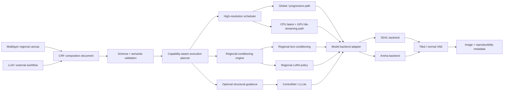

# Forge Neo High-Resolution Regional Generation: Technical Research Review

## Executive summary

The ten research tracks in the original plan converge on one architectural conclusion: **do not build the project around a single “tiled diffusion” algorithm.** The strongest design is a common orchestration layer with at least two execution strategies: a global-first/progressive mode for difficult composition and an aggressively streamed tiled mode for low-VRAM operation. DemoFusion provides evidence for progressive upscaling with global/local sampling; AccDiffusion v2 provides stronger evidence that repeated full-image prompts are themselves a source of duplicated content and that patch-aware prompting, local structural guidance, and cross-window global sampling materially address the problem. SyncDiffusion independently supports the importance of synchronizing local diffusion processes rather than treating seamless blending as equivalent to semantic coherence. citeturn3academia48turn3academia47turn3academia49

Forge Neo is already substantially more capable than a greenfield integration would assume. Its current documentation lists Anima 2B/2.9B/3.8B support, Anima-specific LoRA/ControlLLLite mapping, SDXL/Anima LLLite with MultiDiffusion support, Anima regional ControlNet, tiled VAE convolution, on-the-fly LoRA control, `torch.compile`, and other memory/performance facilities. Forge Couple now advertises Forge Neo and Anima support, regional conditioning, editable regions, global conditioning, masks, and a tile mode. Consequently, the new extension should **reuse Forge's model loading, memory/offload, ControlNet, LoRA, and conditioning machinery wherever possible rather than recreate them.** citeturn2search1turn2search0turn2search2

The largest unresolved technical risk is **true regional LoRA isolation**. Existing evidence establishes regional text conditioning and independently controllable LoRA lifecycle/timestep behavior, but it does not establish that arbitrary LoRA effects can be perfectly confined to geometric masks. The safest product design is therefore to expose two semantics: a fast approximate regional mode and a more expensive prediction-level “strict” mode, while documenting that even prediction-level masking cannot necessarily prevent all cross-region influence inside a denoiser.

The CRF concept is sound, but it should become an **execution-independent scene-description format**, not a serialization of Forge internals. Geometry, prompt inheritance, adapter intent, overlap semantics, and optional structural controls should be declarative; backend capability negotiation should decide how precisely SDXL or Anima can implement those semantics. The first version should support boxes and polygons inline, with raster masks carried in an optional bundle rather than embedded as huge base64 strings.

The recommended development order remains close to the original plan, with one important refinement: **benchmark infrastructure should begin before the algorithms are implemented, not at the end.** Track every candidate against composition, object count, leakage, seam quality, runtime, peak VRAM/RAM, deterministic replay, and interruption recovery. Literature claims about “4K,” “8K,” or “low VRAM” should not determine product limits until the exact Forge Neo execution paths are measured on 4, 6, 8 and 12 GB configurations.

## Cross-topic comparison

Effort below is my engineering estimate for one experienced developer producing a defensible prototype and benchmark evidence, not a measured schedule. It excludes production hardening and extensive cross-platform testing.

| Track | Scope | Maturity | Critical dependencies | Main risk | Prototype effort |
|---|---|---|---|---|---:|
| High-resolution algorithms | Global-first, tiled and progressive native txt2img | Medium–high research maturity; medium integration maturity | Denoiser hooks, scheduler semantics, latent geometry | Composition can be seamless yet semantically wrong | 3–5 weeks |
| Forge Neo/model internals | SDXL/Anima execution and extension hooks | Medium–high, but rapidly evolving | Forge Neo source, Anima adapters, extension APIs | Depending on unstable/internal hooks | 2–4 weeks |
| Low-VRAM engineering | Streaming, offload, tiled VAE, caching | Techniques mature; combined implementation unproven | Forge memory manager, PyTorch/CUDA, backend adapter | RAM/PCIe cost negates VRAM savings | 4–6 weeks |
| Global coherence/intelligence | Automatic patch semantics and unique-object preservation | Medium | High-res scheduler, structural representation | Patch captioning introduces contradictory semantics | 4–8 weeks |
| Regional conditioning/LoRAs | Regional prompts and adapter isolation | Text conditioning: medium–high; strict LoRA isolation: low–medium | Attention hooks, LoRA lifecycle, masks | Leakage and combinatorial compute | 5–8 weeks |
| Regional canvas | Multilayer non-destructive editor | UX patterns mature; Forge integration medium | Browser canvas layer, state model, CRF | UI state diverges from generation state | 2–4 weeks |
| CRF protocol | Portable scene/region interchange | Underlying standards mature; CRF itself new | Conditioning semantics, canvas model | Freezing ambiguous semantics too early | 1–3 weeks |
| Structural guidance | ControlNet/LLLite/layout/depth/edge | Medium–high in Forge ecosystem | Track 2 and region geometry | Model residency destroys low-VRAM target | 3–5 weeks |
| Compatibility/code reuse | Hooks, cleanup, seeds, licenses, ecosystem | Continuous engineering concern | Every execution path | Silent extension collisions/regressions | 2–4 weeks initial |
| Evaluation/benchmarking | Reproducible quality/performance suite | Methodology mature; project suite new | Representative hardware and prompts | Optimizing to weak proxy metrics | 1–2 weeks setup; ongoing |

The dependency structure argues strongly against ten independent implementations. Tracks 1–5 and 8 should share a generation planner; Tracks 5–8 should share one region model; Tracks 6–7 should share one document/state representation; Track 10 should exercise all of them.



The important boundary is `Model backend adapter`: **SDXL and Anima should share orchestration and CRF semantics, but not be forced through identical attention, positional, sampling, or adapter implementations.**

## Algorithms, model internals, and memory engineering

**Track 1 — High-resolution diffusion algorithms**

**Executive summary.** The evidence favors a portfolio rather than a winner. DemoFusion is a strong global-first SDXL baseline; AccDiffusion v2 is the most directly relevant baseline for patch-aware semantic decomposition; SyncDiffusion is useful evidence that coherence needs an explicit cross-window mechanism. U-Net-specific methods such as HiDiffusion and ScaleCrafter remain valuable SDXL candidates, but they should not define the Anima architecture before model-specific source inspection.

**Key findings and technical evidence.** DemoFusion extends pretrained latent diffusion models with progressive upscaling, skip-residual injection and dilated sampling. Its own authors explicitly acknowledge the cost of the progressive design: additional passes, although those intermediate stages can double as previews. That trade is attractive for a “quality-first” Forge mode because the low-resolution generations continuously re-establish the large-scale scene instead of expecting independent high-resolution patches to discover it. citeturn3academia48

AccDiffusion v2 identifies two particularly relevant failure mechanisms: using the same global text on every high-resolution patch promotes repeated content, while omitting useful patch text damages detail. Its response is a combination of patch-content-aware prompts, auxiliary structural information through ControlNet, and dilated/window-interacting sampling intended to restore global semantic information. The work was subsequently published in *IEEE TPAMI* in 2025, making it especially important as a baseline rather than merely an experimental GitHub technique. citeturn3academia47turn3search14

SyncDiffusion attacks a related problem from another direction: it synchronizes locally denoised regions using a perceptual-similarity objective rather than assuming overlap averaging alone gives a globally coherent image. That distinction matters for this project: **seam elimination and global scene coherence are separate objectives.** citeturn3academia49

| Candidate | Most useful idea for this project | Likely role | Main concern |
|---|---|---|---|
| DemoFusion | Progressive/global structure carried upward through resolutions | Quality-first SDXL path | Repeated model passes and latency |
| AccDiffusion v2 | Patch-aware prompts + structural guidance + interacting windows | Primary direct/tiled research baseline | Extra prompt/control pipeline complexity |
| SyncDiffusion | Explicit synchronization across local generations | Experimental coherence module / benchmark | Additional optimization cost |
| HiDiffusion | Resolution-aware U-Net / efficient windowing | SDXL optimization candidate | U-Net-specific assumptions |
| ElasticDiffusion | Global/local content separation | Strong architectural research candidate | Must validate against Forge/Anima implementation |
| ScaleCrafter | Receptive-field changes for extrapolation | SDXL experimental backend | Architecture-specific modifications |

The last three remain **benchmark candidates rather than architectural commitments** in this report; I did not obtain sufficiently complete primary-source/code evidence for them in the final verification pass to rank them above the first three.

**Practical implications and next steps.** Implement the high-resolution interface so that global and tile prediction strategies are pluggable. The first benchmark should compare native-resolution baseline, naive overlapping tiles, DemoFusion-style progressive generation, and an AccDiffusion-v2-inspired patch-aware path. Keep “progressive” and “direct tiled” as separate user modes unless evidence demonstrates one dominates.

**Gaps and validation.** The principal unanswered experiment is whether the global mechanisms that help SDXL remain useful when applied to Anima's actual denoising implementation. Also measure whether patch-aware prompting still helps when explicit CRF regions already supply local semantics; it may become redundant for manually authored scenes but remain critical in automatic mode.

**Priority sources.** [DemoFusion paper](https://arxiv.org/abs/2311.16973) citeturn3academia48; [AccDiffusion v2 paper](https://arxiv.org/abs/2412.02099) citeturn3academia47; [AccDiffusion v2 TPAMI record](https://pubmed.ncbi.nlm.nih.gov/40471731/) citeturn3search14; [SyncDiffusion paper](https://arxiv.org/abs/2306.05178) citeturn3academia49; [HiDiffusion paper](https://arxiv.org/abs/2311.17528); [ScaleCrafter project](https://scalecrafter.github.io/); [ElasticDiffusion project](https://elasticdiffusion.github.io/).

**Track 2 — Forge Neo and model internals**

**Executive summary.** Forge Neo should be treated as an active execution platform, not just a UI host. The current repository already exposes or implements several capabilities the plan was considering building—Anima support, model-specific adapter mapping, regional ControlNet, MultiDiffusion-compatible LLLite, tiled VAE convolution and dynamic LoRA controls—so duplicating those facilities would increase compatibility risk without obvious benefit. citeturn2search1

**Key findings and technical evidence.** As of the current repository state, Forge Neo documents Anima 2B, 2.9B and 3.8B support and says LoRA/ControlLLLite mapping is handled automatically for the latter two model sizes. It also documents LLLite for both SDXL and Anima with MultiDiffusion support, Anima Region ControlNet, tiled `Conv2d` for VAE memory reduction, `torch.compile`, and on-the-fly LoRA control. citeturn2search1

Forge Couple's current documentation says it supports Forge Classic/Neo and now Anima, and its implementation concept is already close to one component of the proposed extension: target different conditioning to specific regions. It supports geometric and mask-oriented modes, global conditioning and a tile mode; critically, its own documentation cautions that regional conditioning cannot make the underlying checkpoint understand a composition that it fundamentally fails to represent. citeturn2search0turn2search2

That means the correct internal boundary is approximately:

```text
CRF / canvas
     ↓
generation planner
     ↓
regional conditioning + tile schedule
     ↓
Forge-native model / LoRA / ControlNet / memory facilities
     ↓
model-specific adapter: SDXL | Anima
```

Do **not** put SDXL-specific U-Net surgery in the common scheduler. Likewise, do not assume an Anima patch can reuse SDXL spatial-position behavior merely because both can generate images.

Forge's current LoRA-control syntax is also a useful indication that adapter lifecycle should remain delegated to Forge where possible:

```text
<lora:name:[w1@t1, w2@t2, ...]>
```

Forge Neo documents this as its on-the-fly LoRA control mechanism. citeturn2search1

**Practical implications and next steps.** Build a small source-level probe extension before any high-resolution engine. It should record denoiser calls, timestep/sigma, conditioning structure, latent shape, attention implementation, active ControlNet/LLLite modules, LoRA lifecycle, interruption callbacks and cleanup behavior for one SDXL and each supported Anima size.

Define a model capability interface rather than `if anima:` branches throughout the code. A minimal shape would expose `predict()`, positional/tile metadata requirements, supported conditioning types, adapter activation semantics, VAE tile capability and whether a global/windowed pass is valid.

**Gaps and validation.** Stable extension-facing hooks versus internal implementation details remain the decisive uncertainty. DMD/Turbo-style accelerated checkpoints also need direct sampler/CFG experiments; no evidence reviewed here justifies assuming they behave exactly like their non-distilled base models.

**Priority sources.** [Forge Neo repository / `neo` branch](https://github.com/Haoming02/sd-webui-forge-classic/tree/neo) citeturn2search1; [Forge Couple](https://github.com/Haoming02/sd-forge-couple) citeturn2search0; [Forge Couple README](https://github.com/Haoming02/sd-forge-couple/blob/main/README.md) citeturn2search2.

**Track 3 — Low-VRAM engineering**

**Executive summary.** Low-VRAM operation should be implemented as an execution-policy layer, independent of the image-quality algorithm. The most defensible design is a CPU-resident master latent plus sequential GPU work windows, combined with Forge's existing model offload and tiled VAE facilities; batching should be opportunistic rather than mandatory.

**Key findings and technical evidence.** Forge Neo already documents tiled VAE convolution specifically as a memory-reduction feature, while acknowledging a speed cost, so a new extension should reuse that path rather than introduce a second VAE tiler. Forge also positions itself around resource optimization and already includes model/runtime optimizations that need to be measured in combination rather than replaced. citeturn2search1

The low-VRAM architecture should separate four memory categories: persistent model weights, temporary model activations, latent/mask/conditioning state, and auxiliary-control models. That distinction matters because moving the master latent to system RAM does not solve an activation peak inside a full-resolution model operation; conversely, quantizing weights does not solve an overly large attention workspace.

A robust scheduler should therefore work approximately as:

```text
master latent in host RAM
       │
       ├─ copy tile + halo → GPU
       │
       ├─ construct only needed conditioning
       │
       ├─ denoiser prediction
       │
       ├─ copy prediction → host
       │
       └─ blend/update master latent
            ↻ next tile / timestep
```

Pinned transfers, overlap between copies and compute, conditioning caches, and multi-tile batches should be **measured optimizations**, not mandatory assumptions. On a 4 GB card, sequential processing may be preferable even when it increases wall time; on 12 GB, two or more tiles at once may be faster.

**Practical implications and next steps.** Make the scheduler ask Forge/PyTorch for the actual available memory immediately before allocating a work batch. Use a simple degradation ladder: normal path → smaller tile batch → smaller tile → stronger offload → optional CPU execution or user-visible failure. Never recover from an OOM by silently changing semantic settings such as sampler, steps or regional prompts.

Record peak GPU allocated/reserved memory, peak process RAM, host↔device transfer volume and time per denoising step. Without those four measurements, “low VRAM” optimizations are difficult to distinguish from simply shifting an unacceptable burden to RAM or PCIe transfers.

**Gaps and validation.** There is not enough evidence to responsibly state “4 GB supports X×Y” or “8 GB supports 4K” before measurements. Those limits depend on SDXL versus Anima size, weight format, active ControlNet/LLLite modules, attention implementation, tile halo, text-encoder residency, VAE mode and whether strict regional LoRA mode requires repeated predictions.

**Priority sources.** [Forge Neo](https://github.com/Haoming02/sd-webui-forge-classic/tree/neo) citeturn2search1; [PyTorch CUDA semantics](https://docs.pytorch.org/docs/stable/notes/cuda.html); [PyTorch scaled-dot-product attention](https://docs.pytorch.org/docs/stable/generated/torch.nn.functional.scaled_dot_product_attention.html); [PyTorch `torch.compile`](https://docs.pytorch.org/docs/stable/torch.compiler.html).

## Coherence, regional conditioning, and structural control

**Track 4 — Global coherence and automatic region intelligence**

**Executive summary.** AccDiffusion v2 supplies the strongest direct evidence for the premise behind this track: giving every patch the same global text is not semantically neutral and can contribute to repeated objects. Automatic high-resolution mode should therefore derive local semantic intent while retaining a global scene representation instead of simply broadcasting the complete prompt into every window. citeturn3academia47

**Key findings and technical evidence.** AccDiffusion v2's decomposition into patch-content-aware prompts, local structural guidance and window interaction is particularly compatible with the proposed architecture because those three functions can be separated. CRF can provide local prompts when the user specifies them; an automatic decomposer can supply them otherwise; and the high-resolution scheduler can independently provide global interaction. citeturn3academia47turn3search14

This suggests three semantic modes:

| Mode | Local semantics | Global structure | Appropriate use |
|---|---|---|---|
| Automatic | Generated from global prompt/composition state | Automatic global pass | Ordinary txt2img |
| Assisted | User global prompt + generated local descriptions | Automatic global pass | Complex scenes without hand masks |
| Explicit CRF | User/LLM region prompts and geometry | Global prompt + global scheduler | Precise layout/control |

An important implication is that **automatic patch prompting and CRF are complements, not competitors**. Explicit regions override or constrain local decomposition; uncovered image areas still benefit from automatic semantic assignment.

For unique-object preservation, a scene representation should track semantic entities separately from literal strings. A request containing “one lighthouse” should not become five independent tile prompts each containing “lighthouse.” Tiles intersecting that object's intended footprint receive the object descriptor; unrelated tiles do not. This is an architectural inference directly motivated by the repetition mechanism identified by AccDiffusion v2. citeturn3academia47

**Practical implications and next steps.** Begin without an always-resident captioning model. First test whether a low-resolution global preview plus deterministic crop analysis, or an LLM decomposition of the original prompt, is enough. Only add a vision captioner if benchmarks show that text-only decomposition cannot reliably determine which patches contain ambiguous objects.

**Gaps and validation.** Compare four conditions on identical scenes: full prompt per tile; no local text; LLM-derived local text; image/content-derived local text. Measure unique-object count, subject identity, relative-position correctness and cross-tile object continuity. Explicitly include objects spanning tile boundaries.

**Priority sources.** [AccDiffusion v2](https://arxiv.org/abs/2412.02099) citeturn3academia47; [DemoFusion](https://arxiv.org/abs/2311.16973) citeturn3academia48; [SyncDiffusion](https://arxiv.org/abs/2306.05178) citeturn3academia49.

**Track 5 — Regional conditioning and true regional LoRAs**

**Executive summary.** Regional text conditioning is already demonstrably feasible in Forge Neo through Forge Couple, including Anima support, but that does **not** prove strict spatial LoRA isolation. The implementation should therefore represent text-region conditioning, adapter activation and prediction blending as separate concepts rather than hide them behind one “regional LoRA” switch. citeturn2search0turn2search2

**Key findings and technical evidence.** Forge Couple targets distinct conditioning to spatial regions and exposes masks, region mappings and a global conditioning mechanism. Forge Neo separately exposes on-the-fly LoRA controls and Anima-specific LoRA handling. The primary documentation reviewed here does not establish that arbitrary LoRA deltas themselves are multiplied by a spatial mask inside every affected layer; consequently, claiming “true regional LoRA” based solely on these existing facilities would be premature. citeturn2search1turn2search0

There are three implementable tiers:

| Tier | Mechanism | Isolation | Cost |
|---|---|---|---|
| Regional text | Different prompt conditioning by region | Good for prompt attributes; not LoRA isolation | Low |
| Adapter-aware regional prediction | Switch/compose LoRAs for regional denoiser evaluations and blend predictions | Stronger spatial isolation | Potentially one prediction per adapter/region group |
| Internal masked adapter | Apply LoRA residual conditionally inside network features/attention | Potentially strongest but architecture-specific | Highest engineering risk |

The middle approach is the safest initial “strict” implementation. For a tile or region \(R\), activate the appropriate adapter set, compute its prediction, then combine predictions using normalized region weights. It does not require rewriting every LoRA-patched layer and can use Forge's existing LoRA lifecycle. It is expensive, and receptive-field/context effects mean “strict” should be understood as **prediction-level spatial isolation**, not a mathematical guarantee that the adapter never influences context outside its geometric region.

Overlaps need explicit normalization. A useful initial semantic rule is:

\[
\hat\epsilon(x)=
\frac{\sum_i w_i(x)\,\hat\epsilon_i(x)}
{\max(\epsilon,\sum_i w_i(x))}
\]

where \(w_i(x)\) combines mask opacity, region strength and overlap policy. This is a proposed CRF/execution semantic, not a claim about current Forge behavior.

**Practical implications and next steps.** Ship regional text conditioning first. Prototype prediction-level LoRA isolation second. Defer network-internal spatial masking until the benchmark demonstrates that prediction-level isolation has unacceptable leakage.

Text-encoder LoRAs require separate semantics. A LoRA that changes text encoding cannot be treated identically to a denoiser-only adapter; either cache separate region embeddings under each adapter state or reject “strict text-encoder LoRA isolation” in CRF v1 when the backend cannot implement it.

**Gaps and validation.** Build adversarial leakage tests: red-style LoRA on left versus blue-style LoRA on right; two character LoRAs with deliberately incompatible traits; overlapping masks; text-encoder LoRA versus denoiser-only LoRA; and one object crossing a regional boundary. Measure both target-region strength and non-target leakage.

**Priority sources.** [Forge Couple](https://github.com/Haoming02/sd-forge-couple) citeturn2search0; [Forge Neo](https://github.com/Haoming02/sd-webui-forge-classic/tree/neo) citeturn2search1; [Regional Prompter](https://github.com/hako-mikan/sd-webui-regional-prompter); [MIGC literature search](https://arxiv.org/search/?query=MIGC&searchtype=all) for the multi-instance leakage/control comparison.

**Track 8 — Additional structural guidance**

**Executive summary.** Structural guidance should remain an optional capability attached to the generation plan, not a prerequisite for high-resolution operation. This is practical because Forge Neo already documents SDXL/Anima LLLite support, MultiDiffusion interoperability, and an Anima regional ControlNet path. citeturn2search1

**Key findings and technical evidence.** AccDiffusion v2 independently provides a strong algorithmic reason to expose structural guidance to high-resolution generation: it uses auxiliary local structure via ControlNet specifically to address local distortion in resolution extrapolation. citeturn3academia47turn3search14

Forge's existing implementation therefore provides a natural integration point rather than requiring a custom ControlNet stack. Current Forge documentation explicitly lists LLLite support for SDXL/Anima and MultiDiffusion, plus Region ControlNet for Anima. citeturn2search1 A 2026 Forge issue also shows active use of Anima regional ControlNet together with colored region masks and Forge Couple, although an issue report should be treated as ecosystem evidence rather than a formal API guarantee. citeturn2search4

The preferred priority is:

**layout/region masks → edge/depth → segmentation → more expensive learned analysis**.

The first controls can often be derived from the CRF document itself. For example, a CRF region layout can create the color-mask input for a regional controller without loading a separate segmentation model.

**Practical implications and next steps.** Introduce a `guidance[]` collection in the internal plan, where each item has type, source, strength, timestep range and affected regions. Let the backend translate that logical object into ControlNet, LLLite or a model-specific controller.

Generate cheap structural maps once, cache them on the CPU, and stream only required crops alongside image tiles. Do not keep every optional control model resident simultaneously on 4–8 GB targets.

**Gaps and validation.** Quantify whether structural guidance still contributes once CRF geometry and patch-aware text are both present. A control path that adds substantial latency/VRAM but only marginally improves explicit-region scenes should remain an advanced option.

**Priority sources.** [Forge Neo](https://github.com/Haoming02/sd-webui-forge-classic/tree/neo) citeturn2search1; [AccDiffusion v2](https://arxiv.org/abs/2412.02099) citeturn3academia47; [ControlNet paper](https://arxiv.org/abs/2302.05543); [Forge Anima regional-ControlNet issue](https://github.com/Haoming02/sd-webui-forge-classic/issues/1221) citeturn2search4.

## Canvas, CRF, and ecosystem integration

**Track 6 — Regional canvas UX**

**Executive summary.** The canvas should not be an image widget with drawing added; it should be a small non-destructive scene editor whose state happens to generate masks. Forge Couple already demonstrates useful primitives—draggable regions, masks, region reordering, reference backgrounds and prompt mapping—but the proposed acceptance test requires a more persistent layer model than its current workflow. citeturn2search0turn2search2

**Key findings and technical evidence.** Forge Couple's Advanced Mode supports selecting and reordering region layers and its Mask Mode supports uploaded/drawn masks, while Basic Mode allows draggable/resizable regions. That existing interaction model is worth preserving where users already understand it, but the new editor needs one canonical state tree rather than having geometry, prompt lines and image masks independently imply one another. citeturn2search0

The canvas state should look conceptually like:

```text
Composition
 ├── canvas metadata
 ├── global conditioning
 └── ordered regions
      ├── geometry
      ├── visibility / locked
      ├── display opacity / color
      ├── effective generation weight
      ├── prompts
      ├── LoRA assignments
      └── structural guidance
```

Display opacity must be distinct from generation weight. Otherwise a user turning down a mask overlay merely to see the photograph beneath it could accidentally alter the generation.

The acceptance test from the original plan should become automated UI behavior: create five regions, select region two, modify shape, reorder it, undo, redo, hide region four, reload the panel, and verify that the other geometries and their conditioning bindings remain unchanged.

**Practical implications and next steps.** Use a dedicated browser-side scene/canvas library rather than round-tripping every brush movement through Python/Gradio. Python should own validated persistent state; the browser should own interaction-rate events such as dragging, painting and zooming.

CRF should be the serialization model or a close derivative of it. That prevents “UI project files” and “LLM-generated regional files” from becoming incompatible formats.

**Gaps and validation.** Large raster masks need performance testing independently of box/polygon editing. Undo history should store commands/deltas rather than copying multi-megabyte mask buffers on every brush stroke.

**Priority sources.** [Forge Couple UI/reference implementation](https://github.com/Haoming02/sd-forge-couple) citeturn2search0; [Konva documentation](https://konvajs.org/docs/); [Fabric.js](https://fabricjs.com/); [Inkscape documentation](https://inkscape.org/learn/).

**Track 7 — CRF communication protocol**

**Executive summary.** The proposed CRF direction is technically sound, but v1 should specify semantics more rigorously than the draft before it becomes a compatibility promise. In particular, `bbox`, overlap, inheritance, adapter scope and masks should have deterministic behavior independent of whichever backend happens to read the document.

**Key findings and technical evidence.** Normalized coordinates are appropriate for portable layouts, but they do not by themselves resolve aspect-ratio changes. CRF should therefore preserve both normalized geometry and the source canvas aspect ratio, and an importer should distinguish `preserve_relative`, `fit`, and explicit user-approved remapping rather than silently stretch a composition.

A recommended v1 data model is:

```json
{
  "format": "coherent-regions",
  "version": 1,
  "canvas": {
    "width": 4096,
    "height": 3072
  },
  "global": {
    "prompt": "professional landscape photograph",
    "negative_prompt": "distortion"
  },
  "regions": [
    {
      "id": "sun",
      "name": "Sun",
      "geometry": {
        "type": "bbox",
        "bbox": [0.70, 0.08, 0.12, 0.16]
      },
      "inherit_global": true,
      "prompt": "one small bright sun",
      "negative_prompt": "multiple suns",
      "blend": {
        "weight": 1.0,
        "z_index": 20
      },
      "loras": []
    }
  ]
}
```

And a partial JSON Schema should enforce structure rather than relying on importer code:

```json
{
  "$schema": "https://json-schema.org/draft/2020-12/schema",
  "type": "object",
  "required": ["format", "version", "canvas", "regions"],
  "properties": {
    "format": { "const": "coherent-regions" },
    "version": { "const": 1 },
    "regions": {
      "type": "array",
      "items": { "$ref": "#/$defs/region" }
    }
  },
  "$defs": {
    "bbox": {
      "type": "array",
      "minItems": 4,
      "maxItems": 4,
      "prefixItems": [
        { "type": "number", "minimum": 0, "maximum": 1 },
        { "type": "number", "minimum": 0, "maximum": 1 },
        { "type": "number", "minimum": 0, "maximum": 1 },
        { "type": "number", "minimum": 0, "maximum": 1 }
      ]
    },
    "region": {
      "type": "object",
      "required": ["id", "geometry"],
      "properties": {
        "id": { "type": "string", "minLength": 1 },
        "inherit_global": { "type": "boolean", "default": true }
      }
    }
  }
}
```

This is a **proposed project schema**, not an existing external standard. It intentionally uses JSON Schema as the validation layer rather than inventing a custom parser.

For geometry, v1 should support:

| Type | Representation | Portability |
|---|---|---|
| Box | Four normalized values | Excellent |
| Polygon | Normalized point list | Excellent |
| Freehand vector | Simplified stroke/path | Good |
| Raster mask | External file reference in bundle | Good |
| Generated/control map | External asset + typed metadata | Good |

For raster compositions, use a bundle such as:

```text
scene.crf/
  composition.json
  masks/
    character-a.png
    foreground.png
  controls/
    depth.png
```

Do not permit arbitrary executable hooks, absolute filesystem paths or automatic network fetching in imported CRF. Treat asset references as data and confine them to the imported bundle.

**Practical implications and next steps.** Freeze semantics before syntax: define coordinate transformation, overlap weights, inheritance, unsupported capability behavior and LoRA scope first. Then produce JSON Schema, canonical examples, invalid examples and round-trip tests.

Add capability negotiation. A backend unable to provide strict regional LoRA behavior should report that condition before generation rather than silently reinterpret the CRF.

**Gaps and validation.** The hardest unresolved choice is overlapping-region semantics. `z_index`, weighted mixture and additive conditioning are meaningfully different operations; CRF should represent them explicitly rather than choose whichever corresponds to the first implementation.

**Priority sources.** [JSON Schema specification](https://json-schema.org/specification); [JSON Schema Draft 2020-12](https://json-schema.org/draft/2020-12); [RFC 8259 — JSON](https://www.rfc-editor.org/rfc/rfc8259).

**Track 9 — Compatibility, stability, and code reuse**

**Executive summary.** Compatibility must be engineered as a lifecycle problem, not just an import problem. Forge's ecosystem already provides real examples of extensions breaking because of prompt preprocessing or UI/runtime-version interactions, so the extension needs explicit ownership of hooks, reversible patches and deterministic cleanup. citeturn2search3turn2search6

**Key findings and technical evidence.** Forge Couple itself documents incompatibility risk when other extensions transform prompts, because its region semantics depend on prompt-line parsing. citeturn2search0 A 2026 issue showed its Advanced Mode failing under Gradio 4.39.0 and recovering after moving to 4.40.0, while another Forge Neo issue documents breakage involving a dynamic-prompts extension. These examples do not imply Forge Neo is inherently unstable; they demonstrate that extensions share mutable execution/UI surfaces and therefore need compatibility tests. citeturn2search3turn2search6

Similarly, a reported Regional Prompter incompatibility in the Forge Classic/Neo ecosystem illustrates why “the extension loaded” is an inadequate compatibility test; generation output must also be checked for whether conditioning is actually taking effect. citeturn2search5

The new extension should therefore use transactional generation state:

```python
# Conceptual pattern, not Forge source code.
state = capture_relevant_state()
try:
    install_generation_hooks()
    execute_plan()
finally:
    remove_generation_hooks()
    restore_relevant_state(state)
```

Every registered attention callback, LoRA state, ControlNet state, sampler modification and temporary tensor should have a corresponding cleanup path that runs after success, user interruption **and** exceptions.

Licensing also needs per-source review before copying code. The Forge Neo repository identifies itself as AGPL-3.0, while Forge Couple's repository documentation carries GPLv3 licensing text; techniques described in papers can usually be independently reimplemented, but copying repository code is a separate licensing question and should be documented file by file. citeturn2search1turn2search0

**Practical implications and next steps.** Produce a compatibility test matrix before release covering normal generation, batch count >1, batch size >1 where supported, interruption, OOM, exception at each hook stage, Hires Fix interaction, ControlNet/LLLite, Forge Couple presence, dynamic prompt preprocessing, LoRA Control, refiner, and saved infotext reload.

Never let the CRF parser depend on the final expanded prompt text. Maintain region IDs as structured state so another prompt-processing extension cannot silently destroy region-to-prompt association.

**Gaps and validation.** The most important source-code investigation still outstanding is exact hook ownership/order under Forge Neo's present extension architecture. This should be proven with a minimal diagnostic extension before the high-resolution implementation starts.

**Priority sources.** [Forge Neo](https://github.com/Haoming02/sd-webui-forge-classic) citeturn2search1; [Forge Couple](https://github.com/Haoming02/sd-forge-couple) citeturn2search0; [Forge Couple Gradio compatibility issue](https://github.com/Haoming02/sd-forge-couple/issues/131) citeturn2search3; [Forge Neo dynamic-prompts issue](https://github.com/Haoming02/sd-webui-forge-classic/issues/1094) citeturn2search6; [Regional Prompter behavior issue](https://github.com/Haoming02/sd-webui-forge-classic/issues/55) citeturn2search5.

## Benchmarking, decision gates, and recommended implementation path

**Track 10 — Objective evaluation and benchmarking**

**Executive summary.** The benchmark must answer product questions rather than simply reproduce paper metrics. Global aesthetics, semantic correctness, regional isolation, seams, VRAM, RAM, speed and failure recovery are separate dimensions, and a candidate should not be declared superior because it improves one aggregate similarity score.

**Key findings and technical evidence.** SyncDiffusion itself evaluates coherence separately from prompt/image-quality measures, illustrating the central methodological point: a seamless montage can still contain globally inconsistent content. citeturn3academia49 AccDiffusion v2 likewise explicitly separates repetition, local distortion and global semantic information in its problem formulation. citeturn3academia47 Those distinctions map well onto the proposed benchmark suite.

The fixed suite should contain at least these classes:

| Test | Example | Primary pass/fail signal |
|---|---|---|
| Count | “one sun, one lighthouse” | Correct count, no duplicates |
| Two subjects | Two named/differentiated people | Identity/attribute isolation |
| Long object | Bridge/train crossing tiles | Continuous geometry |
| Global geometry | Coastline, street, room perspective | No contradictory horizons/perspectives |
| Regional LoRA | Adapter A left, adapter B right | Target adherence + leakage |
| Overlap | Two partially overlapping regional influences | Defined CRF semantics reproduced |
| Structural control | Layout/depth/edge | Alignment without quality collapse |
| Large texture | Terrain/ocean/clouds | Seam and repetition resistance |
| Interruption | Cancel mid-denoise | Clean state and subsequent valid run |
| OOM degradation | Deliberately tight VRAM | Predictable fallback / clean error |

For each generation, log:

```text
software commit
model + hash
VAE / text encoder
weight/quantization format
sampler + scheduler
steps / CFG / model-specific parameters
seed + RNG mode
width / height
tile size / overlap / traversal
high-resolution algorithm
regional / LoRA / control configuration
peak GPU allocated + reserved memory
peak system RAM
wall time
per-step timing
fallbacks taken
```

Use at least several seeds per condition. For difficult compositional prompts, pair automated scoring with blinded pairwise human comparisons. Object-count and attribute-placement tests should be scored explicitly rather than inferred from one generic image/text embedding score.

**Practical implications and next steps.** Establish baseline images and benchmark scripts **before** implementing the candidate methods. Run the same suite after every architectural change; otherwise an optimization for VRAM can quietly regress composition or regional control.

Maintain two leaderboards, not one: **quality-first** and **low-VRAM efficiency**. A 4 GB implementation that is slower but enables a previously impossible resolution is a meaningful result even if it should not become the default on a 24 GB card.

**Gaps and validation.** Hardware results remain entirely unresolved until measured. The project should not publish maximum resolutions for 4/6/8/12 GB based on another repository's benchmark because Forge version, model size, quantization, controls, attention backend and VAE behavior can move the boundary materially.

**Priority sources.** [AccDiffusion v2](https://arxiv.org/abs/2412.02099) citeturn3academia47; [SyncDiffusion](https://arxiv.org/abs/2306.05178) citeturn3academia49; [GenEval](https://arxiv.org/abs/2310.11513); [TIFA](https://arxiv.org/abs/2303.11897).

The resulting decision gates should be explicit:

| Architectural decision | Recommended default now | Evidence that should change it |
|---|---|---|
| Direct tiled vs progressive | Support both; global/progressive for quality, streamed tiles for VRAM | One method dominates both composition and cost across the fixed suite |
| Shared SDXL/Anima path | Shared orchestration, separate backend adapters | Source inspection proves denoiser/position/control semantics genuinely interchangeable |
| Full global attention | Avoid requiring it at maximum resolution | Measured memory/runtime shows it is practical at target VRAM |
| Regional conditioning | Separate attention/text and prediction-level modes | Internal masked-adapter method clearly outperforms without unacceptable coupling |
| LoRA isolation | Fast approximate + optional stricter prediction blending | Source/code experiment proves reliable cheap internal spatial LoRA masking |
| Automatic decomposition | Enable for unstructured prompts; bypass/augment with explicit CRF | Benchmark shows decomposition harms explicit scene descriptions |
| CRF overlap | Explicit policy in the document | Never infer behavior from drawing order |
| ControlNet/LLLite | Optional capability | Only make mandatory if benchmark shows no viable unguided path |

The highest-value implementation sequence is therefore:

**Foundation:** diagnostic Forge Neo extension, benchmark harness, model-capability abstraction, reproducibility metadata.

**First generation prototype:** overlapping tiled SDXL path with CPU master latent, Forge-native tiled VAE and clean interruption/error handling.

**Coherence:** low-resolution/global state plus AccDiffusion-v2-style patch semantics; then compare with progressive DemoFusion-style execution. DemoFusion and AccDiffusion v2 should be baselines, not codebases around which the extension is permanently structured. citeturn3academia48turn3academia47

**Regional control:** structured region objects replacing prompt-line parsing; Forge-native conditioning first; ControlNet/LLLite second; prediction-level regional LoRA prototype third. Forge already provides much of the adjacent infrastructure. citeturn2search1turn2search0

**Anima:** implement only after tracing its actual Forge denoising and positional path. The same CRF and scheduler interfaces can be retained while model-specific prediction logic stays behind the backend adapter.

**Product layer:** CRF schema and round-trip tests, then the persistent multilayer canvas against those semantics. This reverses the usual mistake of making a drawing UI first and attempting to infer generation semantics from it later.

**Hardening:** extension-collision tests, all exception paths, batch behavior, metadata, presets, deterministic replay and 4/6/8/12 GB benchmark runs. The existing Forge ecosystem has enough documented compatibility failures to make this a release requirement rather than polish. citeturn2search3turn2search5turn2search6

The most consequential open questions are still empirical. **No current evidence justifies fixing a maximum resolution by VRAM tier, claiming strict spatial LoRA isolation, or asserting that an SDXL-specific high-resolution intervention will transfer unchanged to Anima.** Those three questions should be treated as proof obligations in `FEASIBILITY.md`, not assumptions in the architecture.

A final literature limitation is also important: the verified primary-source set in this review is strongest through DemoFusion, SyncDiffusion and the 2025 TPAMI version of AccDiffusion v2. HiDiffusion, ElasticDiffusion and ScaleCrafter remain credible candidates from the original plan, but I would not rank them definitively—and would not claim a 2025–2026 method is the new state of the art—without running their current primary implementations against the same Forge-specific benchmark. That is preferable to selecting an architecture from paper headline resolutions that were obtained under different models, memory paths and evaluation criteria.